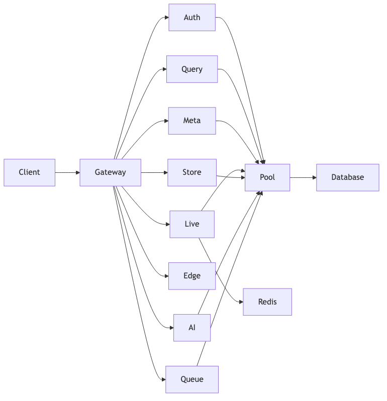

# 📚 IndusBase Documentation

Welcome to the comprehensive IndusBase documentation. This folder contains complete documentation for all services, SDKs, operations, and business strategy.

## 📖 Table of Contents

### Getting Started
- [Architecture Overview](./architecture.md) - High-level system architecture with diagrams
- [Quick Start Guide](./getting-started.md) - Get up and running in 5 minutes

### Business Strategy
- [Business Plan](./business-plan.md) - Strategic roadmap and revenue model
- [Pricing Strategy](./pricing.md) - Detailed pricing tiers and comparison
- [Market Analysis](./market-analysis.md) - Market research and competitive analysis

### Diagrams
- [Comprehensive Diagrams](./diagrams-comprehensive.md) - 40+ architecture diagrams in Mermaid, ASCII, and PNG

### Core Services
| Service | Language | Port | Description |
|---------|----------|------|-------------|
| [indus-gate](./services/indus-gate.md) | Zig | 8000 | API Gateway |
| [indus-auth](./services/indus-auth.md) | Go | 8001 | Authentication |
| [indus-query](./services/indus-query.md) | Rust | 8002 | Auto REST API |
| [indus-pool](./services/indus-pool.md) | Rust | 5432 | Connection Pooler |
| [indus-meta](./services/indus-meta.md) | Go | 8003 | DDL Management |

### Advanced Services
| Service | Language | Port | Description |
|---------|----------|------|-------------|
| [indus-live](./services/indus-live.md) | Gleam | 8004 | Realtime WebSocket |
| [indus-store](./services/indus-store.md) | Go | 8005 | Object Storage |
| [indus-edge](./services/indus-edge.md) | Zig | 8006 | Edge Functions |
| [indus-ai](./services/indus-ai.md) | Rust | 8007 | Vector Search |
| [indus-queue](./services/indus-queue.md) | Go | 8008 | Job Queue |
| [indus-studio](./services/indus-studio.md) | SvelteKit | 3000 | Web Dashboard |

### SDKs
| SDK | Language | Description |
|-----|----------|-------------|
| [indusbase-js](./sdks/indusbase-js.md) | TypeScript | JavaScript/TypeScript client |
| [indusbase-py](./sdks/indusbase-py.md) | Python | Python client |

### Operations
| Topic | Description |
|-------|-------------|
| [Observability](./operations/observability.md) | Prometheus, Grafana, Alerting |
| [CLI](./operations/cli.md) | Developer command-line tool |

---

## 🏗️ Architecture


> 💡 **Tip**: View all architecture diagrams in the [diagrams folder](./diagrams/)

---

## 🚀 Quick Links

| Resource | URL |
|----------|-----|
| Dashboard | http://localhost:3000 |
| API Gateway | http://localhost:8000 |
| Auth API | http://localhost:8001 |
| Query API | http://localhost:8002 |
| Meta API | http://localhost:8003 |
| Live API | http://localhost:8004 |
| Storage API | http://localhost:8005 |
| Edge Functions | http://localhost:8006 |
| AI Service | http://localhost:8007 |
| Queue Service | http://localhost:8008 |
| Prometheus | http://localhost:9091 |
| Grafana | http://localhost:3001 |

---

## 📁 Documentation Structure

```
documentation/
├── README.md                    ← This file
├── architecture.md             ← System architecture
├── business-plan.md            ← Business strategy & revenue model
├── pricing.md                  ← Pricing tiers & comparison
├── market-analysis.md          ← Market research & competition
├── diagrams-comprehensive.md    ← 40+ diagrams
├── getting-started.md         ← Quick start guide
├── mermaid_to_png.py         ← Diagram conversion script
├── diagrams/                  ← Generated PNG images
├── services/
│   ├── indus-gate.md         ← API Gateway
│   ├── indus-auth.md          ← Authentication
│   ├── indus-query.md         ← Auto REST API
│   ├── indus-pool.md          ← Connection Pooler
│   ├── indus-meta.md          ← DDL Management
│   ├── indus-live.md          ← Realtime
│   ├── indus-store.md         ← Storage
│   ├── indus-edge.md          ← Edge Functions
│   ├── indus-ai.md            ← Vector Search
│   ├── indus-queue.md         ← Job Queue
│   └── indus-studio.md        ← Dashboard
├── sdks/
│   ├── indusbase-js.md        ← TypeScript SDK
│   └── indusbase-py.md        ← Python SDK
└── operations/
    ├── observability.md        ← Monitoring
    ├── cli.md                 ← CLI Tool
    └── troubleshooting.md     ← Common issues
```

---

## 🔗 Service Communication Flow



---

## 🛠️ Development

### Running Locally

```bash
# Start all services
docker-compose up -d

# Check health
make health-all

# View logs
docker-compose logs -f
```

### Building

```bash
# Build all services
make build-all

# Build specific service
make build-gate
make build-auth
make build-query
```

---

## 📊 Complete Service Summary

| # | Service | Language | Port | Purpose |
|---|---------|----------|------|---------|
| 1 | **indus-gate** | Zig 0.14 | 8000 | API Gateway, JWT, Rate Limiting |
| 2 | **indus-auth** | Go 1.23 | 8001 | Authentication, JWT, OTP, OAuth |
| 3 | **indus-query** | Rust 2021 | 8002 | Auto REST API from PostgreSQL |
| 4 | **indus-pool** | Rust 2021 | 5432 | PostgreSQL Connection Pooling |
| 5 | **indus-meta** | Go 1.23 | 8003 | DDL Management, Migrations |
| 6 | **indus-live** | Gleam 1.10 | 8004 | Realtime WebSockets |
| 7 | **indus-store** | Go 1.23 | 8005 | S3-compatible Storage |
| 8 | **indus-edge** | Zig 0.14 | 8006 | Edge Functions Runtime |
| 9 | **indus-ai** | Rust 2021 | 8007 | Vector Search + AI |
| 10 | **indus-queue** | Go 1.23 | 8008 | Jobs + Webhooks |
| 11 | **indus-studio** | SvelteKit 5 | 3000 | Web Dashboard |
| 12 | **cli** | Go 1.23 | - | Developer CLI |
| 13 | **ollama** | - | 11434 | Local AI Embeddings |

---

## 🌟 Key Features

### Core Features
- ✅ **Auto REST API** - Create APIs instantly from PostgreSQL tables
- ✅ **Real-time Subscriptions** - WebSocket connections for live data
- ✅ **Object Storage** - S3-compatible file storage
- ✅ **Edge Functions** - Serverless TypeScript functions
- ✅ **Connection Pooling** - Efficient PostgreSQL connections

### AI & ML
- ✅ **Vector Search** - Semantic search with pgvector
- ✅ **AI Embeddings** - OpenAI, Cohere, or local Ollama
- ✅ **RAG Pipelines** - Build AI-powered applications

### Background Processing
- ✅ **Job Queue** - PGMQ-style background jobs
- ✅ **Webhooks** - Trigger HTTP calls on database changes
- ✅ **Cron Jobs** - Scheduled tasks (IST timezone)

### India-Specific
- ✅ **WhatsApp OTP** - via Gupshup
- ✅ **Aadhaar eKYC** - via UIDAI
- ✅ **DPDP Compliance** - Data protection dashboard
- ✅ **IST Cron** - India timezone support

---

## 📞 Support

- GitHub: https://github.com/indusbase/indusbase
- Discord: https://discord.gg/indusbase
- Documentation: https://docs.indusbase.io

---

Built with ❤️ in India 🇮🇳
