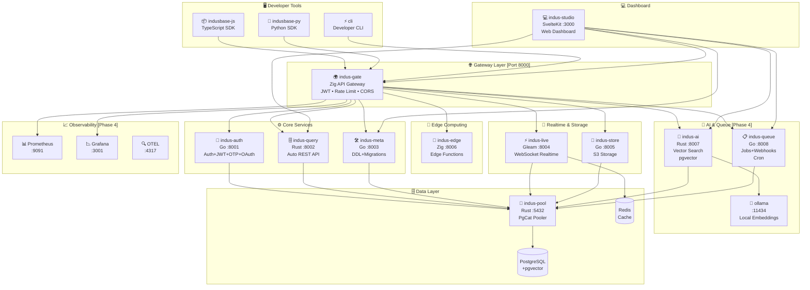
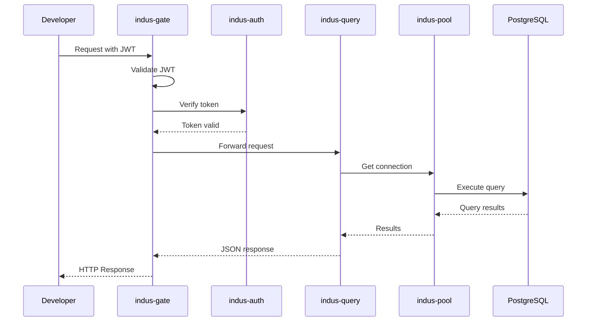
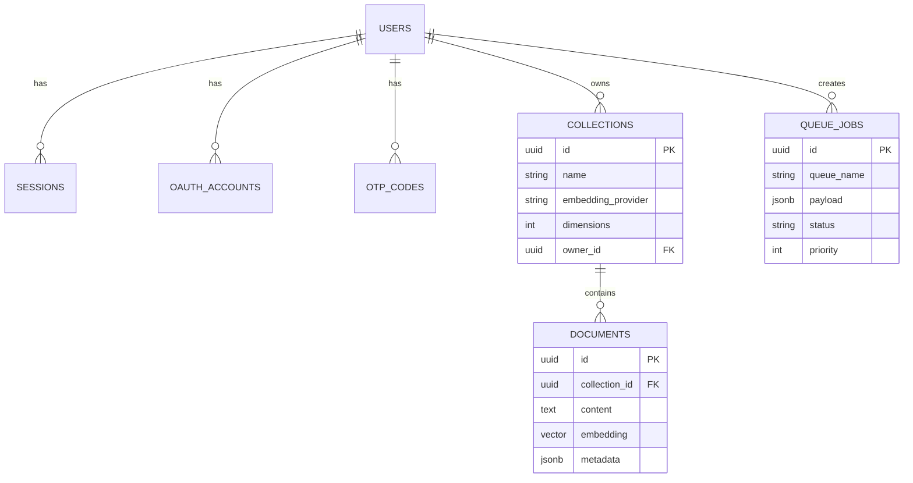

# 🏗️ IndusBase Architecture Overview

Welcome to IndusBase - a **Postgres-native Backend-as-a-Service (BaaS)** platform built for India.

## Architecture Diagram


> 💡 **Tip**: View the source Mermaid code in the [diagrams folder](./diagrams/)



---

## 📊 Service Summary

| # | Service | Language | Port | Purpose |
|---|---------|----------|------|---------|
| 1 | **indus-gate** | Zig 0.14 | 8000 | API Gateway, JWT, Rate Limiting |
| 2 | **indus-auth** | Go 1.23 | 8001 | Authentication, JWT, OTP, OAuth |
| 3 | **indus-query** | Rust 2021 | 8002 | Auto REST API from PostgreSQL |
| 4 | **indus-pool** | Rust 2021 | 5432 | PostgreSQL Connection Pooling |
| 5 | **indus-meta** | Go 1.23 | 8003 | DDL Management, Migrations |
| 6 | **indus-live** | Gleam 1.10 | 8004 | Realtime WebSockets |
| 7 | **indus-store** | Go 1.23 | 8005 | S3-compatible Storage |
| 8 | **indus-edge** | Zig 0.14 | 8006 | Edge Functions Runtime |
| 9 | **indus-ai** 🆕 | Rust 2021 | 8007 | Vector Search + AI |
| 10 | **indus-queue** 🆕 | Go 1.23 | 8008 | Jobs + Webhooks |
| 11 | **indus-studio** | SvelteKit 5 | 3000 | Web Dashboard |
| 12 | **cli** | Go 1.23 | - | Developer CLI |
| 13 | **ollama** 🆕 | - | 11434 | Local AI Embeddings |

---

## 🌟 Key Features

### Core Features
- ✅ **Auto REST API** - Create APIs instantly from PostgreSQL tables
- ✅ **Real-time Subscriptions** - WebSocket connections for live data
- ✅ **Object Storage** - S3-compatible file storage
- ✅ **Edge Functions** - Serverless TypeScript functions
- ✅ **Connection Pooling** - Efficient PostgreSQL connections

### AI & ML (NEW)
- ✅ **Vector Search** - Semantic search with pgvector
- ✅ **AI Embeddings** - OpenAI, Cohere, or local Ollama
- ✅ **RAG Pipelines** - Build AI-powered applications

### Background Processing (NEW)
- ✅ **Job Queue** - PGMQ-style background jobs
- ✅ **Webhooks** - Trigger HTTP calls on database changes
- ✅ **Cron Jobs** - Scheduled tasks (IST timezone)

### India-Specific
- ✅ **WhatsApp OTP** - via Gupshup
- ✅ **Aadhaar eKYC** - via UIDAI
- ✅ **DPDP Compliance** - Data protection dashboard
- ✅ **IST Cron** - India timezone support

---

## 🚀 Quick Start

```bash
# Clone and start
git clone https://github.com/yourorg/indusbase.git
cd indusbase

# Copy environment
cp .env.example .env

# Start all services
docker-compose up -d

# Check health
curl http://localhost:8000/health
```

---

## 📁 Project Structure

```
indusbase/
├── cli/                      # Developer CLI (Go)
├── indus-gate/              # API Gateway (Zig)
├── indus-auth/              # Authentication (Go)
├── indus-query/             # Query Service (Rust)
├── indus-pool/             # Connection Pool (Rust)
├── indus-meta/             # DDL Management (Go)
├── indus-live/             # Realtime (Gleam)
├── indus-store/            # Storage (Go)
├── indus-edge/             # Edge Functions (Zig)
├── indus-ai/               # Vector Search (Rust)
├── indus-queue/            # Job Queue (Go)
├── indus-studio/           # Dashboard (SvelteKit)
├── indusbase-js/           # TypeScript SDK
├── indusbase-py/           # Python SDK
├── observe/               # Observability
├── docker-compose.yml      # All services
└── Makefile               # Build commands
```

---

## 🔗 Service Communication



---

## 🗄️ Database Schema



---

## 📡 API Endpoints

| Service | Base URL | Endpoints |
|---------|----------|-----------|
| indus-gate | `http://localhost:8000` | `/`, `/health` |
| indus-auth | `http://localhost:8001` | `/auth/*` |
| indus-query | `http://localhost:8002` | `/rest/*` |
| indus-meta | `http://localhost:8003` | `/meta/*` |
| indus-live | `http://localhost:8004` | `/ws/*` |
| indus-store | `http://localhost:8005` | `/storage/*` |
| indus-edge | `http://localhost:8006` | `/functions/*` |
| indus-ai | `http://localhost:8007` | `/ai/*` |
| indus-queue | `http://localhost:8008` | `/queue/*` |
| indus-studio | `http://localhost:3000` | `/*` |

---

## 🛠️ Technology Stack

| Component | Technology |
|-----------|------------|
| Gateway | Zig 0.14 |
| Auth | Go 1.23 |
| Query | Rust 2021 |
| Pooler | Rust 2021 + PgCat |
| DDL | Go 1.23 |
| Realtime | Gleam 1.10 |
| Storage | Go 1.23 |
| Edge | Zig 0.14 |
| AI | Rust 2021 + pgvector |
| Queue | Go 1.23 |
| Dashboard | SvelteKit 5 |
| SDKs | TypeScript, Python |
| Database | PostgreSQL 16 |
| Cache | Redis 7 |

---

## 📄 License

MIT License - See LICENSE file for details.

---

Built with ❤️ in India for the world.
