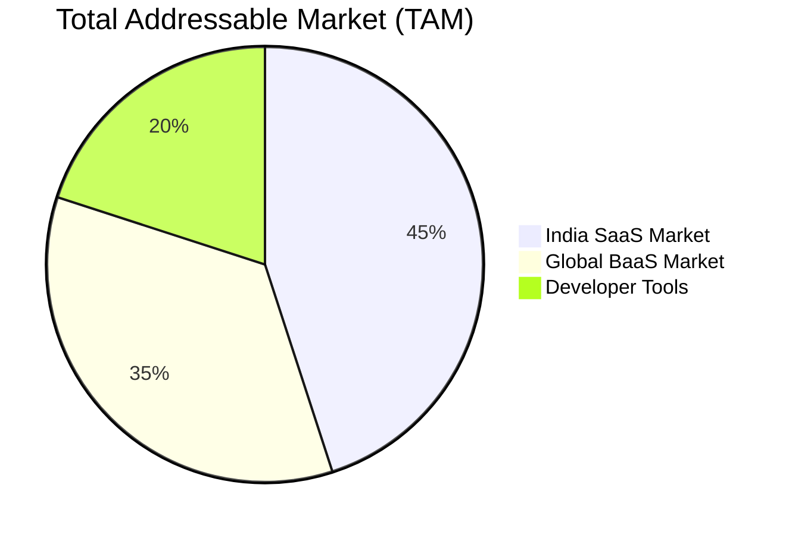
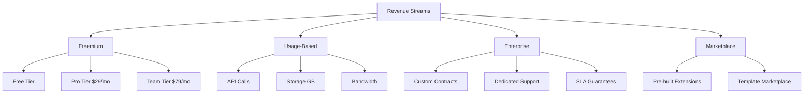
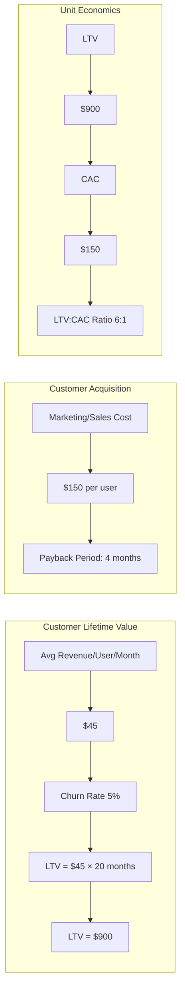
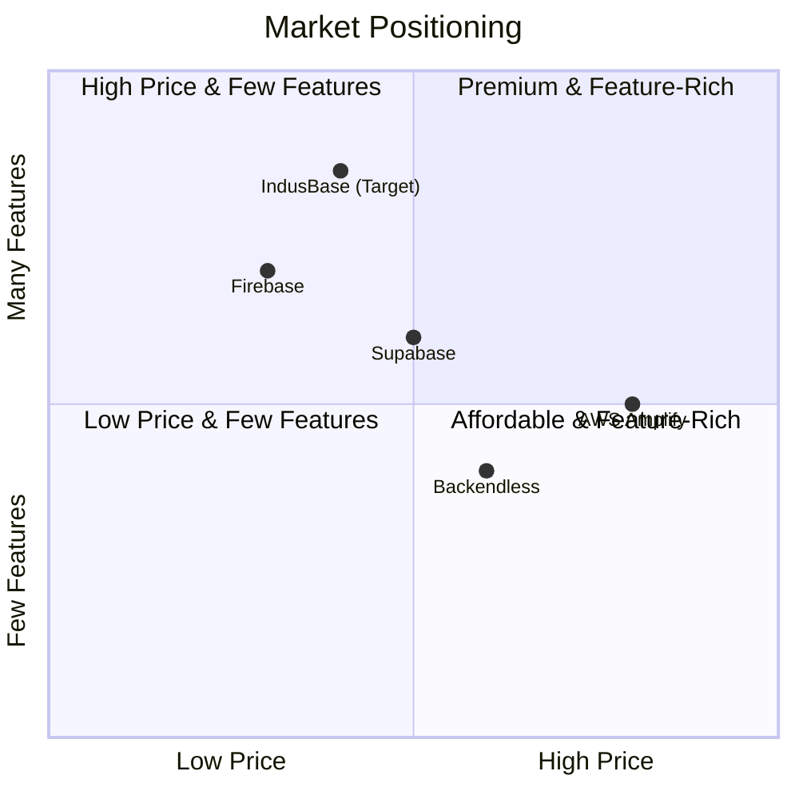
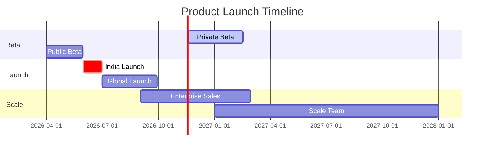
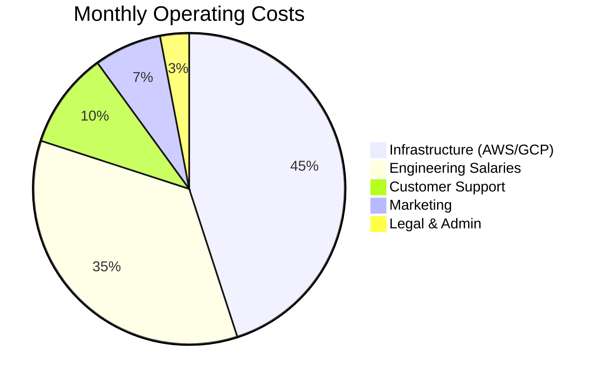

# IndusBase Business Plan

> Strategic roadmap for building a profitable Postgres-native Backend-as-a-Service platform

---

## Executive Summary

**IndusBase** is a Postgres-native Backend-as-a-Service (BaaS) platform designed specifically for the Indian market, with global expansion potential. Positioned as a "1,000x faster Firebase alternative," IndusBase provides developers with instant APIs, real-time subscriptions, authentication, storage, edge functions, and AI capabilities—all powered by PostgreSQL.

### Mission Statement

> "Democratize backend development for Indian developers and businesses by providing a powerful, affordable, and locally-relevant Firebase alternative built on PostgreSQL."

### Vision

Become the leading BaaS platform in India and emerging markets, empowering 1 million developers to build applications faster without managing infrastructure.

---

## 1. Market Opportunity

### 1.1 Target Market Size



| Market Segment | Size (USD) | Growth Rate |
|---------------|------------|-------------|
| India SaaS | $45B | 25% CAGR |
| Global BaaS | $35B | 30% CAGR |
| Developer Tools | $20B | 22% CAGR |

### 1.2 Target Audience

1. **Primary**: Indian startups and SMBs building web/mobile apps
2. **Secondary**: Individual developers and freelancers
3. **Tertiary**: Enterprise developers needing rapid prototyping

### 1.3 Pain Points We Solve

| Pain Point | Traditional Solution | IndusBase Solution |
|------------|---------------------|---------------------|
| Backend setup takes weeks | Hire backend developers | Instant APIs in minutes |
| Database management | Dedicated DB admin | Managed PostgreSQL |
| Real-time features | Build WebSocket servers | Built-in subscriptions |
| Authentication | Implement OAuth/Auth0 | Ready-to-use auth |
| File storage | S3 bucket setup | One-click storage |
| Scaling | DevOps team | Auto-scaling |
| Cost | $5K+/month for team | Pay as you grow |

---

## 2. Business Model

### 2.1 Revenue Streams



### 2.2 Pricing Tiers

| Feature | Free | Pro ($29/mo) | Team ($79/mo) | Enterprise (Custom) |
|---------|------|---------------|---------------|---------------------|
| **API Calls** | 10K/mo | 100K/mo | 1M/mo | Unlimited |
| **Database Size** | 500MB | 10GB | 100GB | Unlimited |
| **Storage** | 1GB | 100GB | 1TB | Unlimited |
| **Projects** | 1 | 10 | Unlimited | Unlimited |
| **Team Members** | 1 | 5 | 25 | Unlimited |
| **Edge Functions** | ❌ | ✅ 50 | ✅ 500 | ✅ Unlimited |
| **Real-time** | 100 conn | 1K conn | 10K conn | Unlimited |
| **AI Embeddings** | ❌ | 10K/mo | 100K/mo | Unlimited |
| **Support** | Community | Email | Priority | Dedicated |
| **SLA** | ❌ | 99.5% | 99.9% | 99.99% |

### 2.3 Unit Economics



| Metric | Value |
|--------|-------|
| Average Revenue Per User (ARPU) | $45/month |
| Customer Lifetime | 20 months |
| Customer Lifetime Value (LTV) | $900 |
| Customer Acquisition Cost (CAC) | $150 |
| LTV:CAC Ratio | 6:1 |
| Payback Period | 4 months |
| Gross Margin | 75% |

---

## 3. Competitive Analysis

### 3.1 Competitor Landscape



### 3.2 Competitive Advantages

| Competitor | Weakness | IndusBase Advantage |
|------------|----------|---------------------|
| **Firebase** | No SQL, vendor lock-in | PostgreSQL-native, portable |
| **Supabase** | Not India-focused | Local pricing, INR support |
| **AWS Amplify** | Complex, expensive | Simpler, 70% cheaper |
| **Backendless** | Legacy tech | Modern stack (Rust/Zig) |

### 3.3 Differentiation Strategy

1. **India-First Pricing**: Prices in INR, localized payment options (UPI, Net Banking)
2. **Data Residency**: All data stored in India (AWS Mumbai, Google Cloud India)
3. **India Integrations**: WhatsApp OTP, Aadhaar eKYC, UPI payments
4. **Local Support**: Hindi/English support, IST timezone
5. **Performance**: Edge locations in Mumbai, Bangalore, Delhi

---

## 4. Go-to-Market Strategy

### 4.1 Launch Phases



### 4.2 Marketing Channels

| Channel | Budget % | Target Users |
|---------|----------|--------------|
| Content Marketing (Dev.to, Hashnode) | 25% | 50K developers |
| YouTube Tutorials | 20% | 100K views |
| Social Media (Twitter/X, LinkedIn) | 15% | 25K followers |
| Developer Communities | 15% | Discord 10K members |
| Partnerships | 15% | 50 startup partners |
| Paid Ads | 10% | 5K trials |

### 4.3 Growth Strategy

```
Phase 1: Product-Led Growth (Months 1-6)
├── Free tier with generous limits
├── Self-serve onboarding
├── In-product referrals
└── Developer evangelism

Phase 2: Community Growth (Months 7-12)
├── Hackathons and competitions
├── University partnerships
├── Content creator partnerships
└── Open-source contributions

Phase 3: Enterprise Sales (Year 2)
├── Dedicated sales team
├── Custom enterprise plans
├── Integration partnerships
└── Government contracts
```

---

## 5. Financial Projections

### 5.1 Revenue Forecast

| Year | Users | MRR | ARR | Burn Rate |
|------|-------|-----|-----|------------|
| 2026 | 1,000 | $45K | $540K | $80K/mo |
| 2027 | 10,000 | $350K | $4.2M | $120K/mo |
| 2028 | 50,000 | $1.5M | $18M | $200K/mo |
| 2029 | 150,000 | $4M | $48M | $300K/mo |
| 2030 | 500,000 | $10M | $120M | $500K/mo |

### 5.2 Cost Structure



### 5.3 Path to Profitability

| Milestone | Target Date |
|-----------|--------------|
| Break-even | Month 24 |
| First profitable month | Month 30 |
| Series A ready | Month 36 |
| IPO ready | Year 5 |

---

## 6. Team & Governance

### 6.1 Founding Team

| Role | Responsibilities |
|------|------------------|
| CEO | Strategy, fundraising, partnerships |
| CTO | Technology, architecture, engineering |
| COO | Operations, HR, finance |
| VP Engineering | Development, devops, security |
| VP Product | Product roadmap, UX |
| VP Sales | Enterprise sales, partnerships |

### 6.2 Advisory Board

- 1x Former SaaS founder (India)
- 1x Database expert (PostgreSQL)
- 1x Enterprise sales leader

---

## 7. Risk Analysis

### 7.1 Identified Risks

| Risk | Probability | Impact | Mitigation |
|------|-------------|--------|------------|
| Competitor price war | High | Medium | Stay差异化 |
| Data center outages | Low | High | Multi-region |
| Key person departure | Medium | High | Equity vesting |
| Regulatory changes | Medium | High | DPDP compliance |
| Market downturn | Medium | Medium | Sustainable burn |

### 7.2 Compliance & Security

- **DPDP Compliant**: Following India's Data Protection guidelines
- **SOC 2 Type II**: Security certification
- **GDPR Ready**: For European expansion
- **ISO 27001**: Information security

---

## 8. Success Metrics

### 8.1 KPIs

| Metric | 6 Months | 12 Months | 24 Months |
|--------|----------|-----------|-----------|
| Active Developers | 1,000 | 10,000 | 50,000 |
| API Requests/Day | 1M | 50M | 500M |
| Revenue | $200K | $2M | $15M |
| NPS Score | 40 | 50 | 60 |
| Churn Rate | <8% | <5% | <3% |

### 8.2 North Star Metric

> **"Number of developers who ship production apps using IndusBase"**

---

## Appendix

### A. Technology Stack

- **Gateway**: Zig 0.14
- **Core Services**: Go 1.23, Rust 2021
- **Realtime**: Gleam 1.10
- **Dashboard**: SvelteKit 5
- **SDKs**: TypeScript, Python
- **Database**: PostgreSQL 16 + pgvector
- **Cache**: Redis 7

### B. Service Architecture

```
┌─────────────────────────────────────────────────────┐
│                    IndusBase Platform                │
├─────────────────────────────────────────────────────┤
│  indus-gate    │ indus-auth    │ indus-query       │
│  indus-pool    │ indus-meta    │ indus-live        │
│  indus-store   │ indus-edge    │ indus-ai          │
│  indus-queue   │ indus-studio  │ CLI + SDKs        │
└─────────────────────────────────────────────────────┘
```

---

**Document Version**: 1.0  
**Last Updated**: March 2026  
**Status**: Strategic Plan - Ready for Review
