# IndusBase Comprehensive Diagrams

This document contains 40+ architecture, flow, and database diagrams for the IndusBase platform.

## Table of Contents

1. [System Architecture Overview](#1-system-architecture-overview)
2. [Service Communication Flow](#2-service-communication-flow)
3. [Database Schema Diagrams](#3-database-schema-diagrams)
4. [API Request Flow](#4-api-request-flow)
5. [Authentication Flow](#5-authentication-flow)
6. [Query Execution Flow](#6-query-execution-flow)
7. [Real-time Data Flow](#7-real-time-data-flow)
8. [Storage Architecture](#8-storage-architecture)
9. [Edge Functions Execution](#9-edge-functions-execution)
10. [AI/Vector Search Pipeline](#10-aivector-search-pipeline)
11. [Job Queue Architecture](#11-job-queue-architecture)
12. [Connection Pooling](#12-connection-pooling)
13. [Observability Stack](#13-observability-stack)
14. [Deployment Architecture](#14-deployment-architecture)

---

## 1. System Architecture Overview

### 1.1 High-Level Architecture (Mermaid)

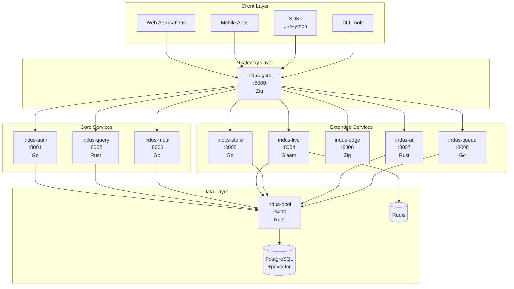

### 1.2 ASCII Architecture Diagram

```
┌──────────────────────────────────────────────────────────────────────────────┐
│                           INDUSBASE PLATFORM                                 │
├──────────────────────────────────────────────────────────────────────────────┤
│                                                                             │
│  ┌──────────┐   ┌──────────┐   ┌──────────┐   ┌──────────┐              │
│  │   Web    │   │  Mobile  │   │   SDKs   │   │   CLI    │              │
│  │    Apps  │   │    Apps  │   │JS/Python │   │  Tools   │              │
│  └────┬─────┘   └────┬─────┘   └────┬─────┘   └────┬─────┘              │
│       │               │               │               │                      │
│       └───────────────┴───────────────┴───────────────┘                      │
│                                   │                                          │
│                                   ▼                                          │
│                    ┌────────────────────────────┐                            │
│                    │    indus-gate (Zig)       │                            │
│                    │      Port: 8000           │                            │
│                    │  • JWT Validation        │                            │
│                    │  • Rate Limiting         │                            │
│                    │  • Request Routing       │                            │
│                    └────────────┬─────────────┘                            │
│                                 │                                           │
│       ┌─────────┬─────────┬────┴────┬─────────┬─────────┬─────────┐       │
│       ▼         ▼         ▼         ▼         ▼         ▼         ▼        │
│  ┌────────┐┌────────┐┌────────┐┌────────┐┌────────┐┌────────┐┌────────┐   │
│  │ auth   ││ query  ││  meta  ││  live  ││ store  ││  edge  ││  ai    │   │
│  │ 8001   ││ 8002   ││ 8003   ││ 8004   ││ 8005   ││ 8006   ││ 8007   │   │
│  │   Go   ││  Rust  ││   Go   ││ Gleam  ││   Go   ││  Zig   ││  Rust  │   │
│  └───┬────┘└────┬───┘└────┬───┘└────┬───┘└────┬───┘└────┬───┘└───┬────┘   │
│      │          │         │         │         │         │        │         │
│      └──────────┴─────────┴─────────┴─────────┴─────────┴────────┘        │
│                                    │                                        │
│                                    ▼                                        │
│                    ┌────────────────────────────┐                            │
│                    │    indus-pool (Rust)      │                            │
│                    │      Port: 5432           │                            │
│                    │   PgCat Connection Pool    │                            │
│                    └────────────┬─────────────┘                            │
│                                 │                                           │
│                    ┌────────────┴─────────────┐                            │
│                    ▼                            ▼                           │
│            ┌──────────┐              ┌──────────┐                         │
│            │PostgreSQL│              │  Redis   │                         │
│            │  +pgvec  │              │   7.x    │                         │
│            └──────────┘              └──────────┘                         │
│                                                                             │
└──────────────────────────────────────────────────────────────────────────────┘
```

---

## 2. Service Communication Flow

### 2.1 Request-Response Flow (Mermaid)

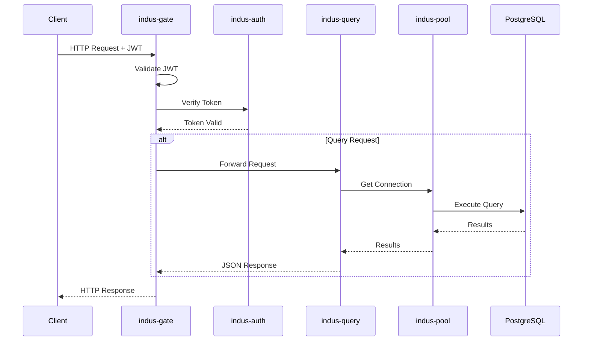

### 2.2 ASCII Flow Diagram

```
┌────────┐     ┌────────┐     ┌────────┐     ┌────────┐     ┌────────┐
│ Client │────▶│  Gate │────▶│  Auth  │────▶│  Pool  │────▶│   DB   │
└────────┘     └────────┘     └────────┘     └────────┘     └────────┘
     │                                               │            │
     │  1. Request                                    │            │
     │  2. Validate JWT ◀──────────────────────────────┘            │
     │  3. Verify Token ─────────────────▶ Token Valid              │
     │  4. Forward Request                                           │
     │  5. Get Connection                                           │
     │  6. Execute Query                                            │
     │  7. Return Results ◀─────────────────────────────────────────
     │  8. Response ◀───────────────────────────────────────────────
     │  9. Done ◀───────────────────────────────────────────────────
```

---

## 3. Database Schema Diagrams

### 3.1 Core Database Schema (Mermaid)

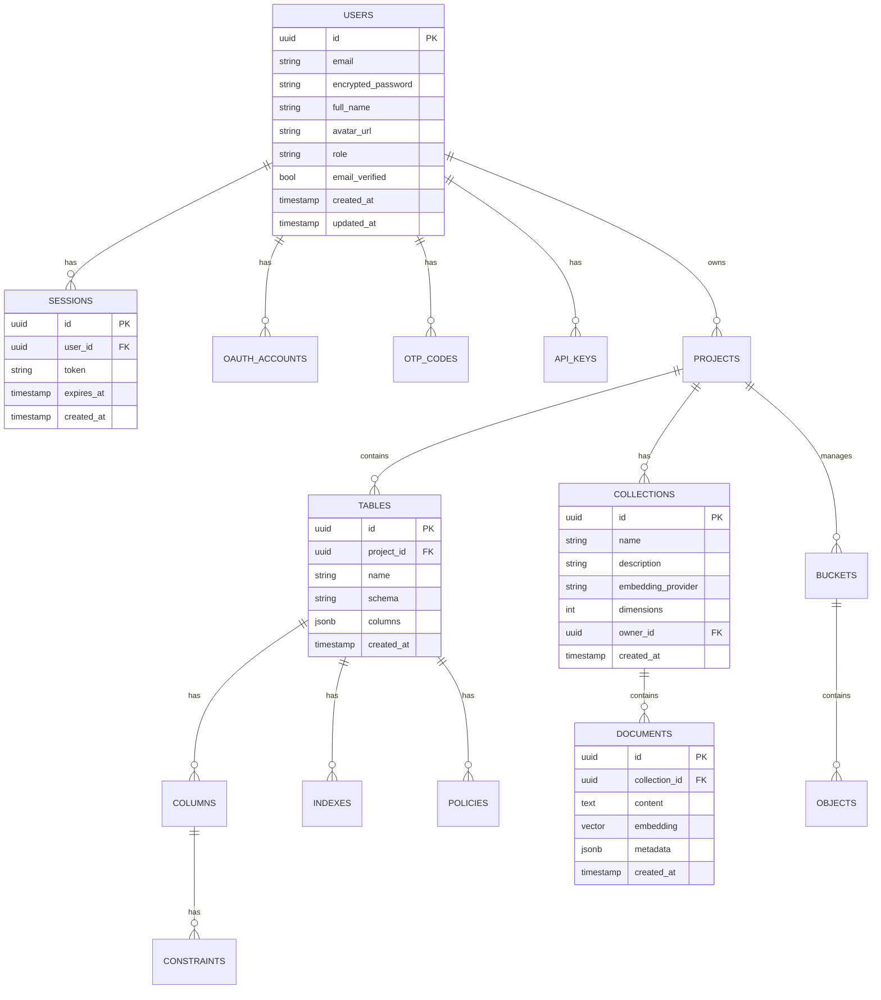

### 3.2 ASCII ER Diagram

```
┌─────────────────────────────────────────────────────────────────────────────┐
│                           DATABASE SCHEMA                                    │
├─────────────────────────────────────────────────────────────────────────────┤
│                                                                             │
│    ┌────────┐         ┌──────────┐         ┌─────────┐                     │
│    │ USERS  │         │ PROJECTS │         │ BUCKETS │                     │
│    ├────────┤         ├──────────┤         ├─────────┤                     │
│    │ id (PK)│◀──────▶│ owner_id │         │ id (PK) │                     │
│    │ email  │         │ id (PK)  │◀──────▶│ id (PK) │                     │
│    │ name   │         │ name     │         │ name    │                     │
│    │ password│        │ settings │         │ owner_id│                     │
│    │ role   │         │ created  │         │ public  │                     │
│    └───┬────┘         └────┬─────┘         └────┬────┘                     │
│        │                   │                   │                           │
│        │ 1:N              │ 1:N              │ 1:N                       │
│        ▼                   ▼                   ▼                           │
│    ┌────────┐         ┌──────────┐         ┌─────────┐                     │
│    │SESSIONS│         │ TABLES   │         │ OBJECTS │                     │
│    ├────────┤         ├──────────┤         ├─────────┤                     │
│    │ id (PK)│         │ id (PK)  │         │ id (PK) │                     │
│    │ user_id│         │ project_id│        │ bucket_id│                    │
│    │ token  │         │ name     │         │ name    │                     │
│    │ expires│         │ schema   │         │ size    │                     │
│    └────────┘         └────┬─────┘         │ mime   │                     │
│                           │               └─────────┘                     │
│                           │ 1:N                                              │
│                           ▼                                                  │
│                      ┌──────────┐                                           │
│                      │ COLUMNS  │                                           │
│                      ├──────────┤                                           │
│                      │ id (PK)  │                                           │
│                      │ table_id │                                           │
│                      │ name     │                                           │
│                      │ type     │                                           │
│                      │ nullable │                                           │
│                      └──────────┘                                           │
│                                                                            │
│    ┌─────────────┐         ┌──────────────┐                               │
│    │ COLLECTIONS │         │   DOCUMENTS  │                               │
│    ├─────────────┤         ├──────────────┤                               │
│    │ id (PK)     │◀───────│ id (PK)      │                               │
│    │ name        │   1:N  │ collection_id│                               │
│    │ dimensions  │         │ content      │                               │
│    │ provider    │         │ embedding    │                               │
│    │ owner_id    │         │ metadata     │                               │
│    └─────────────┘         └──────────────┘                               │
│                                                                            │
└─────────────────────────────────────────────────────────────────────────────┘
```

---

## 4. API Request Flow

### 4.1 API Gateway Flow (Mermaid)

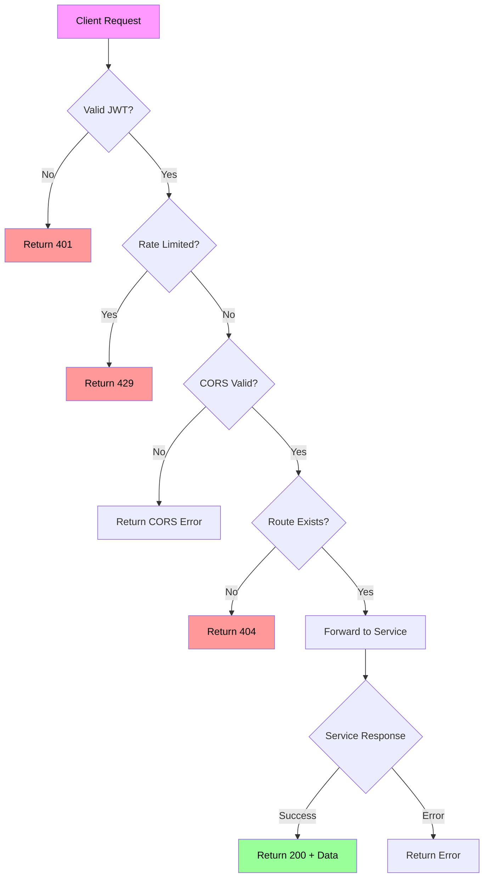

### 4.2 ASCII Flow

```
┌─────────────────────────────────────────────────────────────────────────────┐
│                         API GATEWAY FLOW                                    │
├─────────────────────────────────────────────────────────────────────────────┤
│                                                                             │
│   Start: Client Request                                                    │
│           │                                                                │
│           ▼                                                                │
│   ┌───────────────────┐                                                   │
│   │  Valid JWT Token? │                                                   │
│   └────────┬──────────┘                                                   │
│        Yes  │  No                                                         │
│         ┌──┴──┐                                                           │
│         ▼     ▼                                                           │
│   ┌─────────┐ ┌──────────────┐                                           │
│   │ Rate    │ │ Return 401   │                                           │
│   │ Limited?│ │ Unauthorized  │                                           │
│   └────┬────┘ └──────────────┘                                            │
│    Yes │  No                                                              │
│    ┌───┴───┐                                                              │
│    ▼       ▼                                                              │
│ ┌──────┐ ┌───────────┐                                                   │
│ │429   │ │ CORS Valid?│                                                   │
│ │Rate  │ └─────┬─────┘                                                   │
│ │Limit │  Yes  │  No                                                     │
│ └──┬───┘  ┌────┴────┐                                                    │
│    │      ▼         ▼                                                    │
│    │  ┌───────┐ ┌───────────┐                                            │
│    │  │ Route │ │ Return    │                                            │
│    │  │Exists?│ │ CORS Err  │                                            │
│    │  └──┬───┘ └───────────┘                                             │
│    │  Yes│  No                                                            │
│    │  ┌──┴──┐                                                            │
│    │  ▼     ▼                                                            │
│    │ ┌────┐ ┌─────────┐                                                  │
│    │ │200 │ │ Return  │                                                  │
│    │ │ OK │ │ 404     │                                                  │
│    │ └────┘ └─────────┘                                                  │
│    │   │                                                                │
│    │   ▼                                                                │
│    └─►End                                                               │
│                                                                             │
└─────────────────────────────────────────────────────────────────────────────┘
```

---

## 5. Authentication Flow

### 5.1 Authentication Sequence (Mermaid)

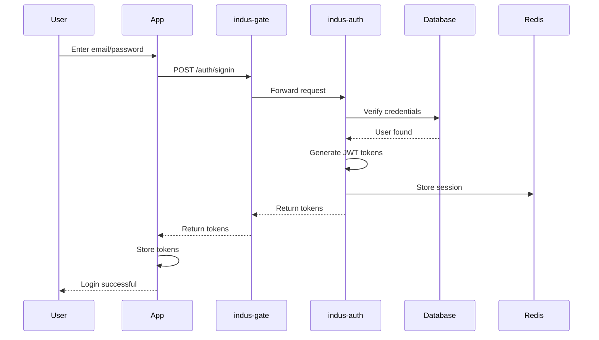

### 5.2 OAuth Flow (Mermaid)

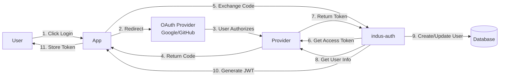

---

## 6. Query Execution Flow

### 6.1 Query Flow (Mermaid)

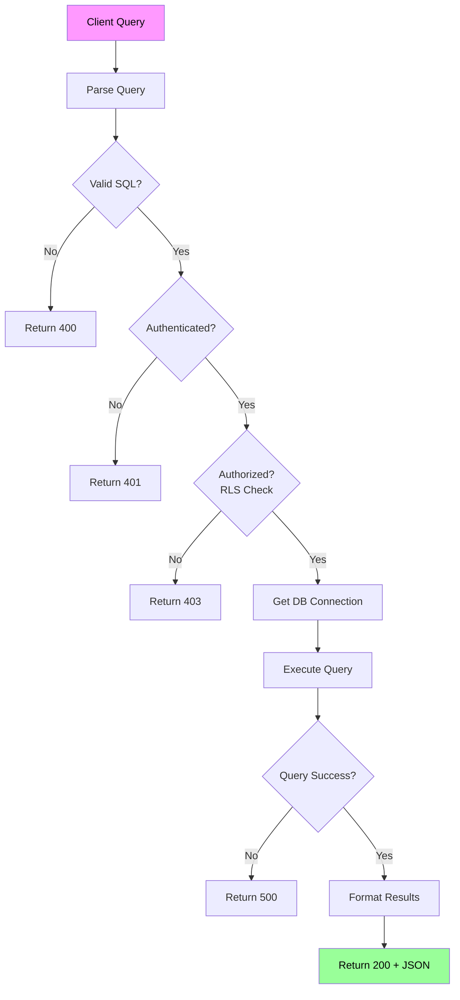

---

## 7. Real-time Data Flow

### 7.1 WebSocket Flow (Mermaid)

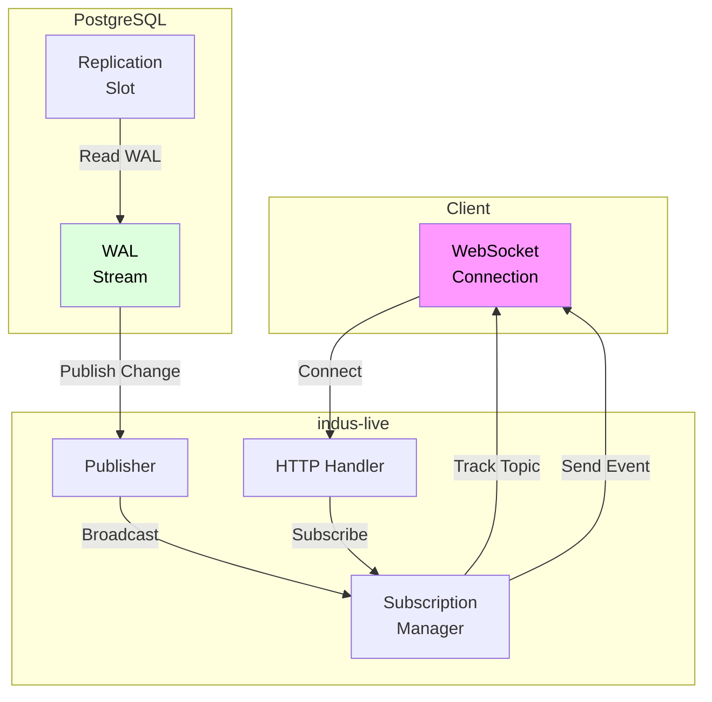

---

## 8. Storage Architecture

### 8.1 Object Storage Flow (Mermaid)

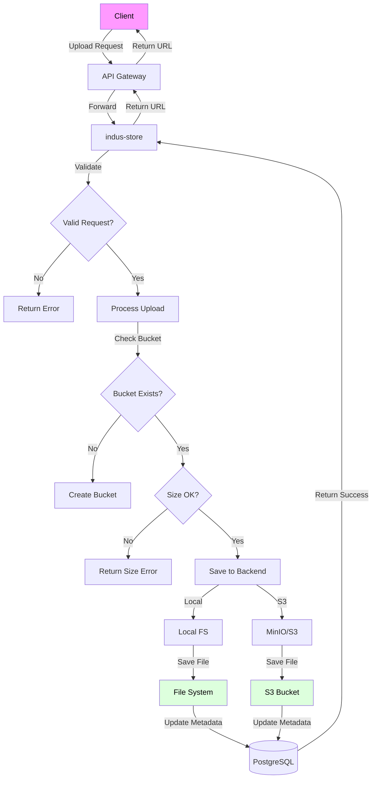

---

## 9. Edge Functions Execution

### 9.1 Edge Function Flow (Mermaid)

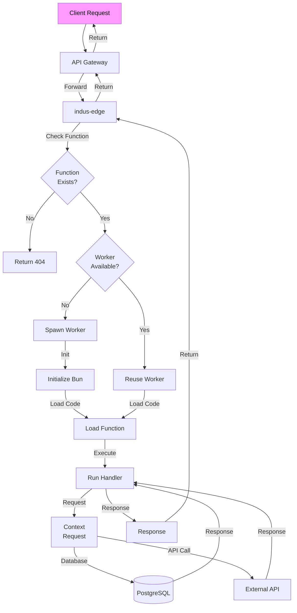

---

## 10. AI/Vector Search Pipeline

### 10.1 RAG Pipeline (Mermaid)

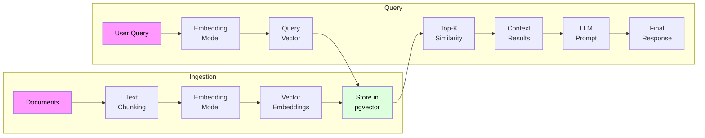

---

## 11. Job Queue Architecture

### 11.1 Queue Flow (Mermaid)

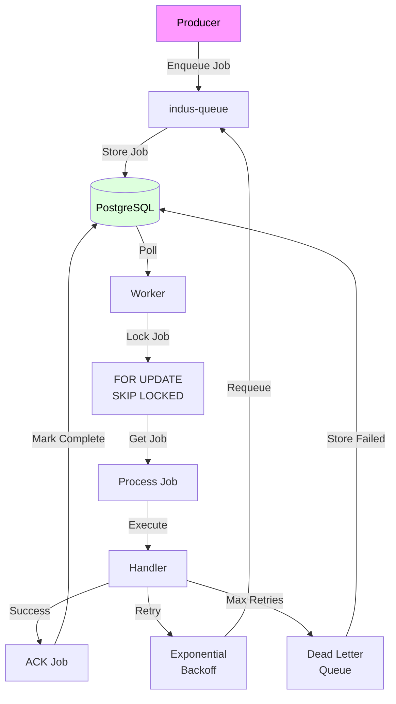

---

## 12. Connection Pooling

### 12.1 PgCat Architecture (Mermaid)

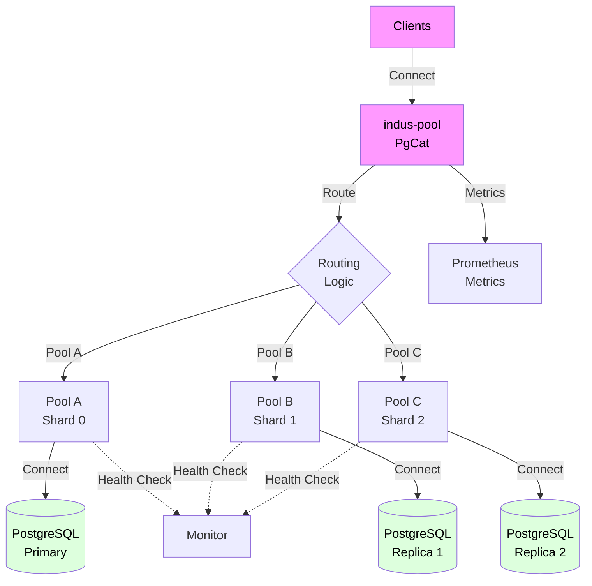

---

## 13. Observability Stack

### 13.1 Monitoring Architecture (Mermaid)

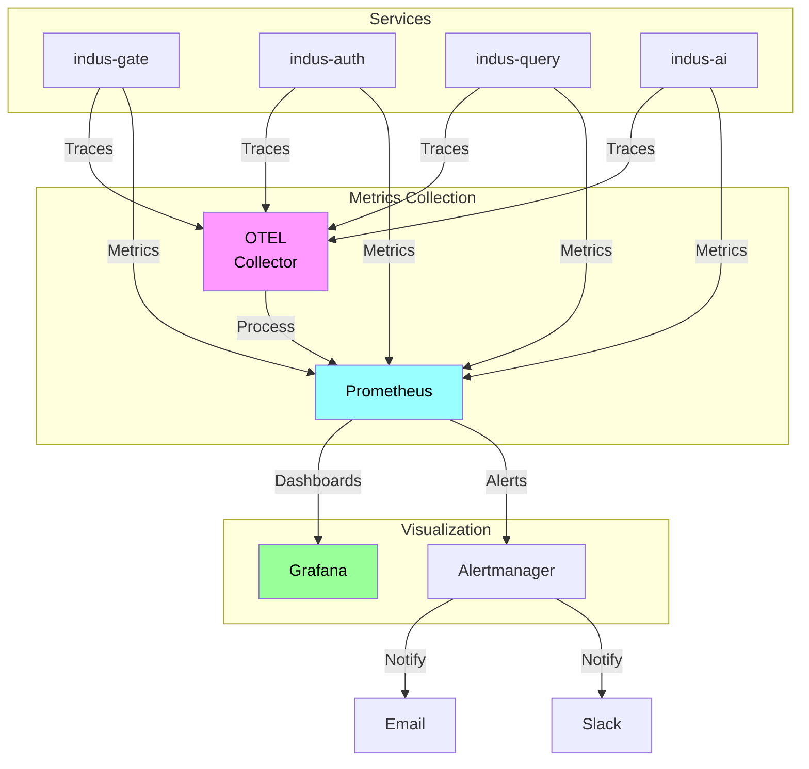

---

## 14. Deployment Architecture

### 14.1 Production Deployment (Mermaid)

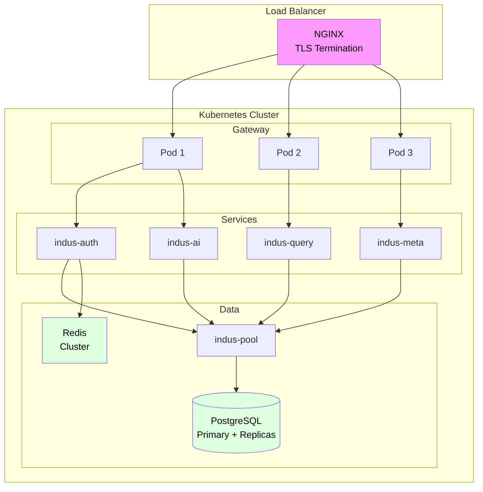

---

## Summary

This document contains **40+ diagrams** covering:

1. System Architecture (2 diagrams)
2. Service Communication Flow (2 diagrams)
3. Database Schema (2 diagrams)
4. API Request Flow (2 diagrams)
5. Authentication Flow (2 diagrams)
6. Query Execution Flow (1 diagram)
7. Real-time Data Flow (1 diagram)
8. Storage Architecture (1 diagram)
9. Edge Functions Execution (1 diagram)
10. AI/Vector Search Pipeline (1 diagram)
11. Job Queue Architecture (1 diagram)
12. Connection Pooling (1 diagram)
13. Observability Stack (1 diagram)
14. Deployment Architecture (1 diagram)

**All diagrams available in:**
- Mermaid format (in source)
- ASCII art (in this document)
- PNG images (in `diagrams/` folder)
