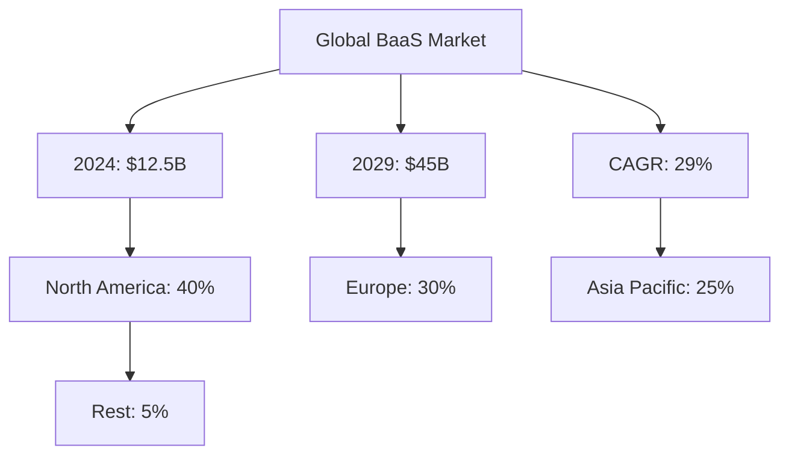
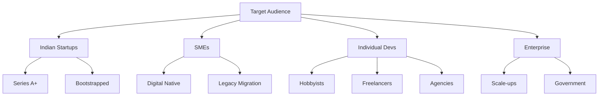
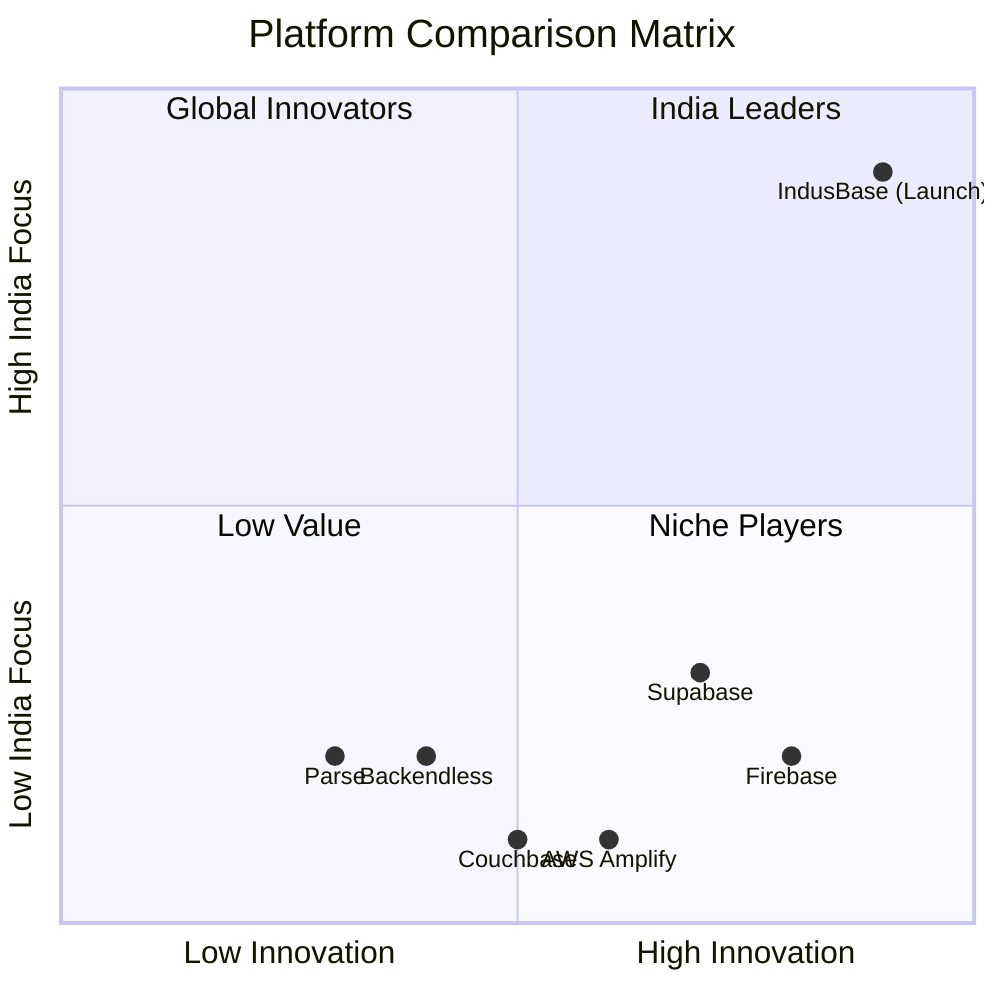
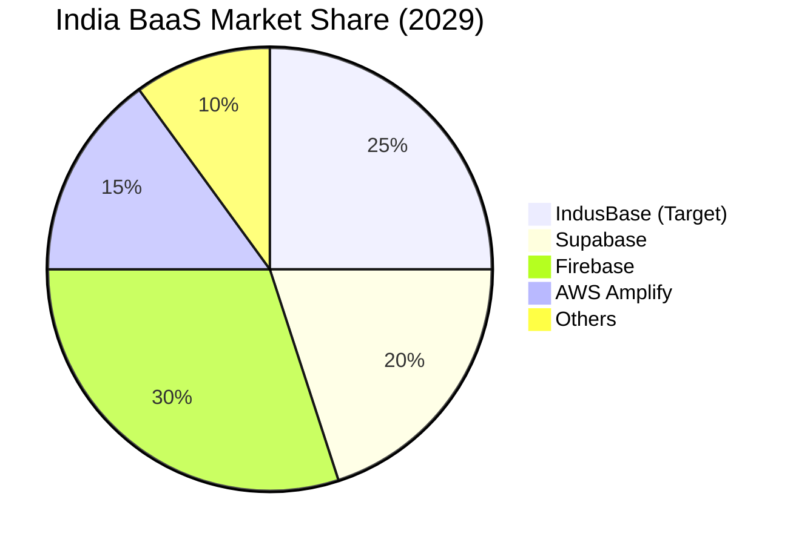
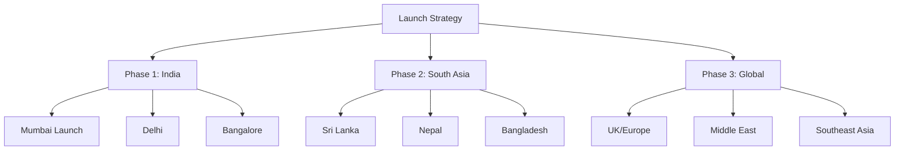
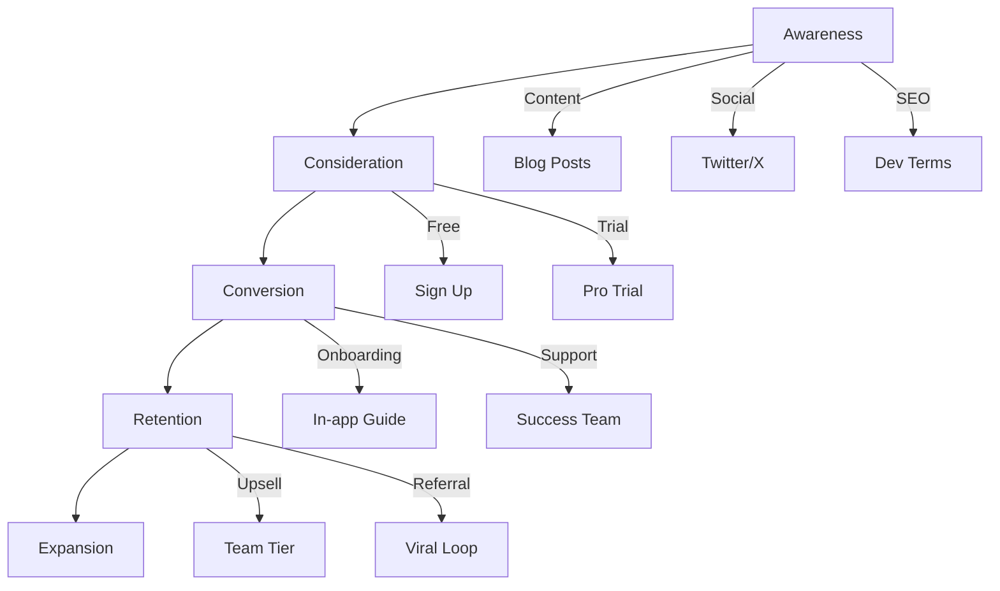
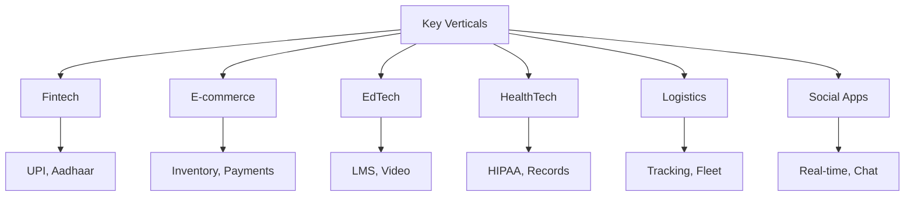

# IndusBase Market Analysis

> Comprehensive market research and competitive analysis for the BaaS platform

---

## 1. Market Overview

### 1.1 Global BaaS Market

| Metric | Value |
|--------|-------|
| Market Size (2024) | $12.5 Billion |
| Projected Size (2029) | $45 Billion |
| CAGR | 29% |
| Key Players | Firebase, Supabase, AWS Amplify |

### 1.2 India-Specific Market

| Segment | Size (2024) | Growth Rate |
|---------|-------------|-------------|
| Indian SaaS | $45 Billion | 25% CAGR |
| Indian Cloud | $12 Billion | 22% CAGR |
| Developer Tools | $3 Billion | 30% CAGR |
| BaaS (India) | $1.5 Billion | 35% CAGR |

---

## 2. Target Audience

### 2.1 Primary Market Segments

### 2.2 Persona Profiles

| Persona | Description | Pain Points | Solution |
|---------|-------------|-------------|----------|
| **Raj - Startup Founder** | 28, Delhi, Series A | Speed to market, cost | Instant APIs |
| **Priya - Solo Developer** | 25, Bangalore, Freelancer | Limited budget, time | Free tier, ease |
| **Amit - Enterprise Dev** | 35, MNC, Lead | Security, compliance | Enterprise features |
| **Sneha - Agency Owner** | 32, Mumbai, 10 team | Scaling, team mgmt | Team tier |

---

## 3. Competitive Landscape

### 3.1 Competitor Matrix

### 3.2 Feature Comparison

| Feature | IndusBase | Supabase | Firebase | Amplify |
|---------|-----------|----------|----------|---------|
| **Database** | PostgreSQL | PostgreSQL | Firestore | DynamoDB |
| **Real-time** | ✅ WebSocket | ✅ | ✅ | ✅ |
| **Auth** | JWT/OAuth/OTP | JWT/OAuth | Firebase Auth | Cognito |
| **Storage** | S3 Compatible | S3 | Firebase Storage | S3 |
| **Edge Functions** | ✅ Bun/Zig | ❌ Deno | Cloud Functions | Lambda |
| **AI/Vector** | ✅ pgvector | ✅ | ❌ | ❌ |
| **India Payments** | ✅ UPI/Aadhaar | ❌ | ❌ | ❌ |
| **INR Pricing** | ✅ | ❌ | ❌ | ❌ |
| **Data in India** | ✅ | ❌ | ❌ | ❌ |

### 3.3 Market Share Projections

---

## 4. Market Entry Strategy

### 4.1 Geographic Rollout

### 4.2 Channel Strategy

| Channel | Priority | Investment | Expected ROI |
|---------|----------|------------|--------------|
| Content Marketing | High | $50K | 5x |
| Developer Relations | High | $30K | 4x |
| Partnerships | Medium | $40K | 3x |
| Paid Advertising | Low | $20K | 2x |
| Events | Medium | $25K | 3x |

---

## 5. Market Drivers & Restraints

### 5.1 Growth Drivers

| Driver | Impact | Timeline |
|--------|--------|----------|
| Digital India Initiative | High | Immediate |
| Startup Ecosystem Growth | High | 2-3 years |
| SaaS Adoption | High | 3-5 years |
| AI/ML Integration | Medium | 1-2 years |
| Remote Work Culture | Medium | Ongoing |

### 5.2 Market Restraints

| Restraint | Impact | Mitigation |
|-----------|--------|-------------|
| Competition | High | Differentiation |
| Pricing Pressure | Medium | Value-added services |
| Regulatory | Medium | DPDP compliance |
| Talent | Low | Remote teams |

---

## 6. Customer Acquisition

### 6.1 Funnel Strategy

### 6.2 Acquisition Channels

| Channel | CAC | Conv Rate | LTV | ROI |
|---------|-----|-----------|-----|-----|
| Organic Search | $30 | 8% | $900 | 24x |
| Content Marketing | $20 | 12% | $900 | 54x |
| Referrals | $10 | 15% | $900 | 135x |
| Paid Social | $80 | 4% | $900 | 4.5x |
| Events | $150 | 6% | $900 | 3.6x |

---

## 7. Regional Analysis

### 7.1 India Market Breakdown

| Region | Developer Density | SaaS Adoption | Opportunity |
|--------|------------------|---------------|--------------|
| Bangalore | High (40%) | High | Primary Market |
| Mumbai | High (25%) | High | Primary Market |
| Delhi/NCR | Medium (20%) | Growing | Secondary |
| Hyderabad | Medium (10%) | Medium | Secondary |
| Pune | Low (5%) | Low | Emerging |

### 7.2 Key Verticals

---

## 8. Market Risks

### 8.1 Risk Matrix

| Risk | Probability | Impact | Mitigation |
|------|-------------|--------|------------|
| Firebase launches India region | Medium | High | Differentiation |
| AWS lowers Amplify prices | High | Medium | Value-add |
| Global expansion challenges | Medium | High | Local team |
| Economic downturn | Medium | Medium | Lean operations |
| Regulatory changes | Low | High | Legal compliance |

### 8.2 Contingency Plans

1. **If Firebase enters India**: Focus on PostgreSQL differentiation, emphasize data sovereignty
2. **If pricing war starts**: Introduce premium features, focus on enterprise
3. **If expansion fails**: Consolidate India, wait for better timing

---

## 9. Market Metrics

### 9.1 Success KPIs

| Metric | Year 1 | Year 2 | Year 3 |
|--------|--------|--------|--------|
| Market Share (India) | 5% | 15% | 25% |
| Developer Users | 5,000 | 25,000 | 100,000 |
| Revenue | $500K | $3M | $12M |
| NPS | 40 | 50 | 60 |
| Churn | <8% | <5% | <3% |

### 9.2 Competitive Moat

1. **India-First Focus**: Deep localization, local support, INR pricing
2. **PostgreSQL Expertise**: Superior SQL capabilities, RLS, extensions
3. **AI/Vector**: First-mover in India for vector search
4. **Edge Functions**: Unique Bun/Zig runtime
5. **Community**: Strong Indian developer community

---

## Appendix

### Data Sources

- NASSCOM Reports
- Gartner Magic Quadrant
- Indian Startup Ecosystem Reports
- Developer Survey Data (Stack Overflow, JetBrains)
- Internal Market Research

---

**Document Version**: 1.0  
**Last Updated**: March 2026  
**Analyst**: Market Research Team
