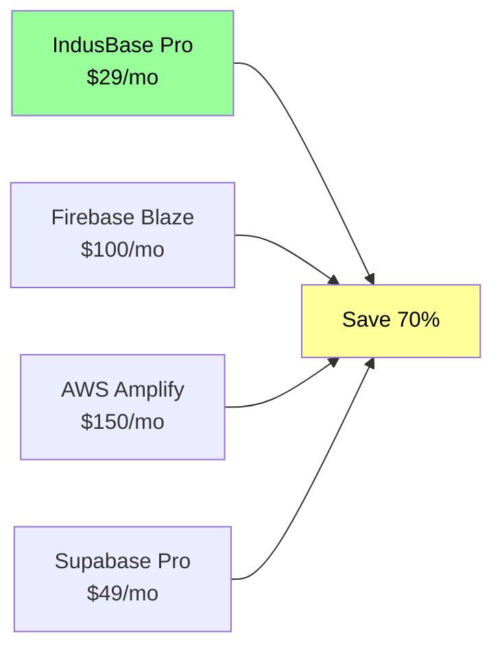
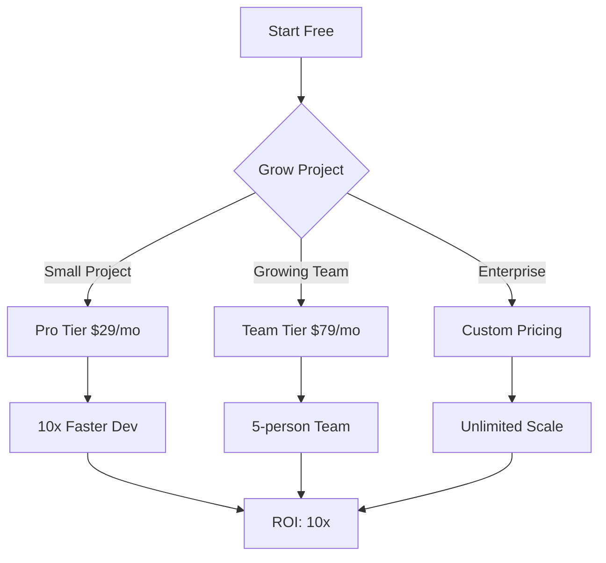
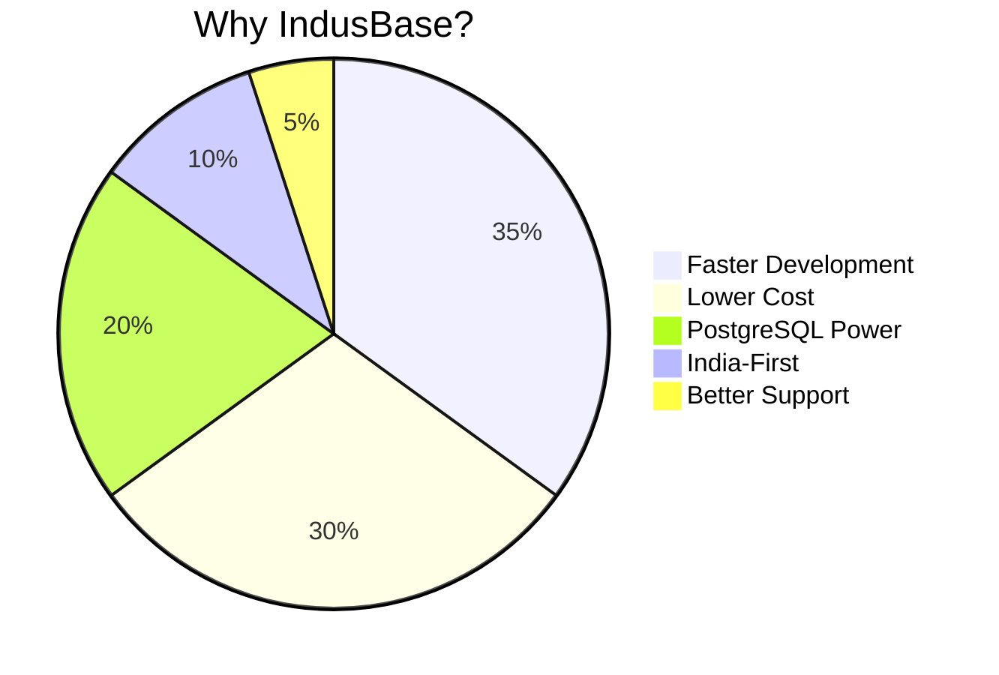

# IndusBase Pricing Strategy

> Comprehensive pricing model for the IndusBase BaaS platform

---

## Pricing Philosophy

At IndusBase, we believe in **fair, transparent pricing** that scales with your project. We offer:

- 🚀 **Generous free tier** for developers to get started
- 💰 **Predictable pricing** with no hidden fees
- 📈 **Volume discounts** for larger projects
- 🇮🇳 **India-first pricing** in INR for local customers

---

## Pricing Tiers

### Comparison with Competitors

| Feature | IndusBase Free | IndusBase Pro | Supabase Free | Firebase Spark | AWS Amplify |
|---------|---------------|---------------|---------------|----------------|--------------|
| **Price** | **Free** | **$29/mo** | Free | Free | Free |
| **API Calls** | 10K/mo | 100K/mo | Unlimited | 150K/mo | 500K/mo |
| **Database** | 500MB | 10GB | 500MB | 1GB | 10GB |
| **Storage** | 1GB | 100GB | 1GB | 1GB | 5GB |
| **Bandwidth** | 10GB | 1TB | 5GB | 1GB | 15GB |
| **Real-time** | 100 conn | 1K conn | 200 conn | 100 conn | 500 conn |
| **Edge Functions** | ❌ | 50 | ❌ | ❌ | 1000 |
| **AI/Vector** | ❌ | 10K emb/mo | ❌ | ❌ | ❌ |
| **SSL** | ✅ | ✅ | ✅ | ✅ | ✅ |
| **Support** | Community | Email | Community | Community | Paid |

### Cost Savings vs Competitors

---

## Detailed Pricing

### Free Tier

**Perfect for**: Hobby projects, learning, prototypes

| Resource | Limit |
|----------|-------|
| Price | **Free forever** |
| Projects | 1 |
| Team Members | 1 |
| API Calls | 10,000/month |
| Database Storage | 500 MB |
| Object Storage | 1 GB |
| Bandwidth | 10 GB/month |
| Real-time Connections | 100 |
| Edge Functions | ❌ |
| AI Embeddings | ❌ |
| SSL Certificate | ✅ |
| Community Support | ✅ |
| Uptime | 99.5% |

---

### Pro Tier - $29/month

**Perfect for**: Solo developers, small startups

| Resource | Limit |
|----------|-------|
| Price | **$29/month** (₹2,400/mo in India) |
| Projects | 10 |
| Team Members | 5 |
| API Calls | 100,000/month |
| Database Storage | 10 GB |
| Object Storage | 100 GB |
| Bandwidth | 1 TB/month |
| Real-time Connections | 1,000 |
| Edge Functions | 50 executions |
| AI Embeddings | 10,000/month |
| SSL Certificate | ✅ |
| Email Support | ✅ |
| Uptime | 99.5% |

**Additional Pro Features:**
- Custom domains
- Advanced analytics
- Webhook retries
- Priority support

---

### Team Tier - $79/month

**Perfect for**: Growing startups, small teams

| Resource | Limit |
|----------|-------|
| Price | **$79/month** (₹6,500/mo in India) |
| Projects | Unlimited |
| Team Members | 25 |
| API Calls | 1,000,000/month |
| Database Storage | 100 GB |
| Object Storage | 1 TB |
| Bandwidth | 10 TB/month |
| Real-time Connections | 10,000 |
| Edge Functions | 500 executions |
| AI Embeddings | 100,000/month |
| SSL Certificate | ✅ |
| Priority Support | ✅ |
| Uptime | 99.9% |

**Additional Team Features:**
- SSO/SAML
- Audit logs
- Role-based access
- Advanced analytics
- Dedicated support

---

### Enterprise Tier - Custom Pricing

**Perfect for**: Large organizations, mission-critical apps

| Resource | Value |
|----------|-------|
| Price | **Custom** |
| Projects | Unlimited |
| Team Members | Unlimited |
| API Calls | Unlimited |
| Database Storage | Unlimited |
| Object Storage | Unlimited |
| Bandwidth | Unlimited |
| Real-time Connections | Unlimited |
| Edge Functions | Unlimited |
| AI Embeddings | Unlimited |
| SSL Certificate | ✅ |
| Dedicated Support | ✅ |
| Uptime | 99.99% |

**Enterprise Features:**
- Dedicated infrastructure
- Custom SLAs
- On-premise deployment option
- Compliance certifications (SOC 2, ISO 27001)
- Dedicated account manager
- 24/7 phone support
- Custom contracts
- Invoice billing

---

## Usage-Based Pricing

For users who exceed their tier limits:

### API Calls

| Tier | Overage Rate |
|------|--------------|
| Free | $0.01 per 1K calls |
| Pro | $0.008 per 1K calls |
| Team | $0.005 per 1K calls |
| Enterprise | Custom |

### Storage

| Resource | Rate |
|----------|------|
| Database (over 100GB) | $0.10/GB/month |
| Object Storage | $0.05/GB/month |
| Backup Storage | $0.02/GB/month |

### Bandwidth

| Tier | Overage Rate |
|------|--------------|
| All Tiers | $0.05/GB |

---

## India-Specific Pricing

### Local Currency Support

| Payment Method | Currency | Processing Fee |
|---------------|----------|---------------|
| UPI | INR (₹) | 0% |
| Net Banking | INR (₹) | 0% |
| Debit Card | INR (₹) | 0% |
| Credit Card | INR (₹) | 2% |
| Wallets | INR (₹) | 1% |

### India Discounts

- **Student Discount**: 50% off Pro tier with .edu email
- **Startup Program**: 1 year free Pro for accepted startups
- **NGO Discount**: 70% off for registered nonprofits

---

## Cost Comparison Calculator

### Monthly Cost Comparison

| Service | Small App | Medium App | Large App |
|---------|-----------|------------|-----------|
| **IndusBase** | **$29** | **$79** | **$299** |
| Supabase | $49 | $149 | $599 |
| Firebase | $25 | $100 | $500+ |
| AWS Amplify | $50 | $150 | $600+ |
| Backendless | $25 | $75 | $250+ |

**Savings**: Save up to **70%** compared to competitors

---

## Enterprise Volume Discounts

| Annual Commitment | Discount |
|------------------|----------|
| $5,000/year | 10% |
| $25,000/year | 20% |
| $100,000/year | 30% |
| $500,000/year | 40% |

---

## Add-ons

### Premium Features

| Add-on | Price | Description |
|--------|-------|-------------|
| Additional Projects | $5/project/mo | Extra projects |
| Extra Team Members | $10/user/mo | Beyond tier limit |
| Advanced Analytics | $29/mo | Detailed usage insights |
| Webhook Retries | $9/mo | Auto-retry failed webhooks |
| Backup Retention | $19/mo | 30-day backup retention |
| Custom SSL | $29/mo | Bring your own SSL |

---

## Frequently Asked Questions

### Billing

**Q: How do I upgrade my plan?**
A: Go to Dashboard → Settings → Billing → Change Plan

**Q: Can I downgrade anytime?**
A: Yes, changes take effect at next billing cycle

**Q: Do you offer refunds?**
A: 30-day money-back guarantee for annual plans

**Q: How is usage calculated?**
A: We track API calls, storage, and bandwidth in real-time

### Technical

**Q: What happens if I exceed limits?**
A: We notify you at 80%, then upgrade or overage billing at 100%

**Q: Is there a limit on database connections?**
A: Pro: 50 concurrent, Team: 200, Enterprise: Custom

**Q: Can I use my own domain?**
A: Yes, Pro tier includes custom domains with free SSL

---

## Pricing Diagrams

### Cost vs Value (Mermaid)

### Value Proposition (Mermaid)

---

## Contact Sales

**Email**: sales@indusbase.io  
**Phone**: +91 98765 43210  
**Website**: https://indusbase.io/pricing

---

**Document Version**: 1.0  
**Last Updated**: March 2026
