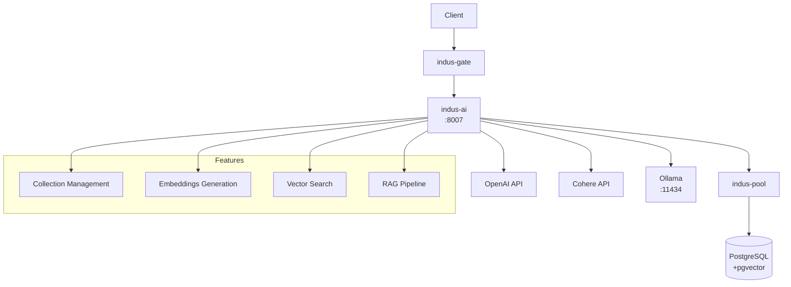

# 🤖 indus-ai - Vector Search & AI Service

The **indus-ai** service provides vector search and AI embeddings powered by pgvector. Built with **Rust**, it supports multiple embedding providers and enables semantic search and RAG pipelines.

## Overview



## Features

- ✅ **Vector Storage** - Store embeddings in PostgreSQL
- ✅ **Multiple Providers** - OpenAI, Cohere, Ollama
- ✅ **Semantic Search** - Cosine, L2, inner product
- ✅ **Metadata Filtering** - Filter by JSONB metadata
- ✅ **Collection Management** - Create/delete/manage collections
- ✅ **Batch Upsert** - Bulk document ingestion
- ✅ **RAG Support** - Build AI applications

## Embedding Providers

### OpenAI
- Model: `text-embedding-3-small`
- Dimensions: 1536
- Cost: Pay per token

### Cohere (Recommended for India)
- Model: `embed-multilingual-v3.0`
- Dimensions: 1024
- Supports: Hindi + 100+ languages

### Ollama (Local/Free)
- Model: `nomic-embed-text`
- Dimensions: 768
- No API costs

## API Endpoints

### Collections

| Method | Endpoint | Description |
|--------|----------|-------------|
| GET | `/ai/collections` | List collections |
| POST | `/ai/collections` | Create collection |
| GET | `/ai/collections/:name` | Get collection |
| DELETE | `/ai/collections/:name` | Delete collection |

### Documents

| Method | Endpoint | Description |
|--------|----------|-------------|
| POST | `/ai/collections/:name/documents` | Upsert documents |
| GET | `/ai/collections/:name/documents/:id` | Get document |
| DELETE | `/ai/collections/:name/documents/:id` | Delete document |

### Search

| Method | Endpoint | Description |
|--------|----------|-------------|
| POST | `/ai/collections/:name/search` | Semantic search |
| POST | `/ai/search` | Multi-collection search |

### Embeddings

| Method | Endpoint | Description |
|--------|----------|-------------|
| POST | `/ai/embed` | Generate embeddings |

## Examples

### Create Collection

```bash
curl -X POST http://localhost:8007/ai/collections \
  -H "Authorization: Bearer $TOKEN" \
  -H "Content-Type: application/json" \
  -d '{
    "name": "product-docs",
    "description": "Product documentation",
    "embedding_provider": "cohere"
  }'
```

### Upsert Documents

```bash
curl -X POST http://localhost:8007/ai/collections/product-docs/documents \
  -H "Authorization: Bearer $TOKEN" \
  -H "Content-Type: application/json" \
  -d '{
    "documents": [
      {
        "content": "How to process payments using UPI",
        "metadata": {"category": "payments", "lang": "en"}
      },
      {
        "content": "UPI भुगतान कैसे करें",
        "metadata": {"category": "payments", "lang": "hi"}
      }
    ]
  }'
```

### Semantic Search

```bash
curl -X POST http://localhost:8007/ai/collections/product-docs/search \
  -H "Authorization: Bearer $TOKEN" \
  -H "Content-Type: application/json" \
  -d '{
    "query": "How do I make payments in India?",
    "limit": 5,
    "min_score": 0.7,
    "filter": {"lang": "en"}
  }'
```

### Response

```json
{
  "data": [
    {
      "id": "uuid",
      "content": "How to process payments using UPI",
      "metadata": {"category": "payments", "lang": "en"},
      "similarity": 0.92,
      "created_at": "2024-01-01T00:00:00Z"
    }
  ]
}
```

## RAG Pipeline Example

```python
from indusbase import create_client

client = create_client("http://localhost:8000", "your-anon-key")

# Index documents
client.ai.collection("knowledge-base").upsert([
    {"content": "IndusBase is India's BaaS platform..."},
    {"content": "UPI is India's real-time payment system..."}
])

# Search
results = client.ai.collection("knowledge-base").search(
    "What is UPI?",
    limit=3
)

# Build AI response
context = "\n".join([r["content"] for r in results["data"]])
prompt = f"Answer based on: {context}\n\nQuestion: What is UPI?"
```

## Project Structure

```
indus-ai/
├── Cargo.toml
├── Cargo.lock
├── Dockerfile
├── src/
│   ├── main.rs
│   ├── config.rs
│   ├── db.rs
│   ├── router.rs
│   ├── embeddings/
│   │   ├── mod.rs
│   │   ├── provider.rs
│   │   ├── openai.rs
│   │   ├── cohere.rs
│   │   └── local.rs
│   ├── handlers/
│   │   ├── mod.rs
│   │   ├── collections.rs
│   │   ├── documents.rs
│   │   ├── search.rs
│   │   ├── embed.rs
│   │   └── health.rs
│   ├── models/
│   │   ├── mod.rs
│   │   ├── collection.rs
│   │   └── document.rs
│   └── middleware/
│       ├── mod.rs
│       ├── auth.rs
│       └── logger.rs
└── migrations/
    └── 001_create_ai_schema.sql
```

## Database Schema

```sql
-- Collections table
CREATE TABLE indusbase_ai.collections (
    id UUID PRIMARY KEY DEFAULT gen_random_uuid(),
    name VARCHAR(100) UNIQUE NOT NULL,
    description TEXT DEFAULT '',
    embedding_provider VARCHAR(50) NOT NULL,
    embedding_model VARCHAR(100) NOT NULL,
    dimensions INTEGER NOT NULL,
    similarity_metric VARCHAR(20) DEFAULT 'cosine',
    owner_id UUID,
    metadata JSONB DEFAULT '{}',
    document_count BIGINT DEFAULT 0,
    created_at TIMESTAMPTZ DEFAULT NOW(),
    updated_at TIMESTAMPTZ DEFAULT NOW()
);

-- Documents table with vector
CREATE TABLE indusbase_ai.documents (
    id UUID PRIMARY KEY DEFAULT gen_random_uuid(),
    collection_id UUID REFERENCES collections(id) ON DELETE CASCADE,
    content TEXT NOT NULL,
    embedding vector(1536),
    metadata JSONB DEFAULT '{}',
    owner_id UUID,
    created_at TIMESTAMPTZ DEFAULT NOW(),
    updated_at TIMESTAMPTZ DEFAULT NOW()
);

-- Indexes for search
CREATE INDEX ON indusbase_ai.documents USING ivfflat (embedding vector_cosine_ops)
    WITH (lists = 100);
```

## Configuration

### Environment Variables

| Variable | Default | Description |
|----------|---------|-------------|
| `SERVER_PORT` | 8007 | Server port |
| `DATABASE_URL` | - | PostgreSQL connection |
| `EMBEDDING_PROVIDER` | local | Provider: openai, cohere, local |
| `OPENAI_API_KEY` | - | OpenAI API key |
| `OPENAI_EMBEDDING_MODEL` | text-embedding-3-small | Model name |
| `COHERE_API_KEY` | - | Cohere API key |
| `COHERE_EMBEDDING_MODEL` | embed-multilingual-v3.0 | Model name |
| `OLLAMA_URL` | http://ollama:11434 | Ollama server |
| `OLLAMA_MODEL` | nomic-embed-text | Model name |

## India-Specific

Cohere is recommended for India because:
- Supports Hindi, Tamil, Telugu, Bengali, and more
- Cheaper than OpenAI
- Low latency from Indian data centers
- INR billing available
