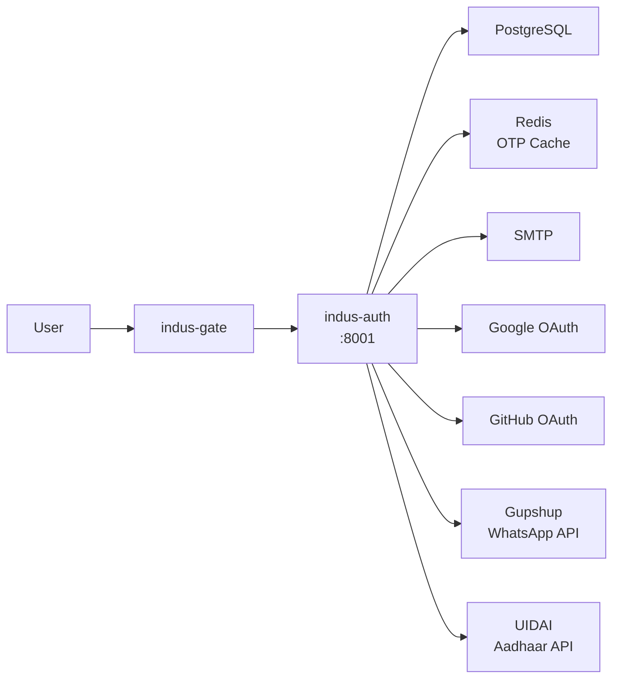

# 🔐 indus-auth - Authentication Service

The **indus-auth** service handles all authentication and authorization for IndusBase. Built with **Go 1.23**, it provides JWT tokens, email OTP, OAuth, and supports India-specific authentication methods.

## Overview



## Features

- ✅ **Email/Password** - Traditional authentication
- ✅ **JWT Tokens** - RS256 signed tokens
- ✅ **Email OTP** - One-time passwords via email
- ✅ **WhatsApp OTP** - OTP via WhatsApp (India)
- ✅ **Google OAuth** - Sign in with Google
- ✅ **GitHub OAuth** - Sign in with GitHub
- ✅ **Aadhaar eKYC** - Identity verification (India)
- ✅ **Session Management** - Redis-backed sessions
- ✅ **Refresh Tokens** - Long-lived refresh tokens

## API Endpoints

### Authentication

| Method | Endpoint | Description |
|--------|----------|-------------|
| POST | `/auth/signup` | Register new user |
| POST | `/auth/signin` | Login with email/password |
| POST | `/auth/signout` | Logout |
| POST | `/auth/verify-otp` | Verify OTP code |
| POST | `/auth/refresh` | Refresh access token |

### OAuth

| Method | Endpoint | Description |
|--------|----------|-------------|
| GET | `/auth/oauth/:provider` | Initiate OAuth flow |
| GET | `/auth/oauth/:provider/callback` | OAuth callback |

### Phone (India)

| Method | Endpoint | Description |
|--------|----------|-------------|
| POST | `/auth/phone/send-otp` | Send OTP via WhatsApp |
| POST | `/auth/phone/verify-otp` | Verify phone OTP |

### Aadhaar (India)

| Method | Endpoint | Description |
|--------|----------|-------------|
| POST | `/auth/aadhaar/send-otp` | Send Aadhaar OTP |
| POST | `/auth/aadhaar/verify-otp` | Verify and get KYC data |

### User Management

| Method | Endpoint | Description |
|--------|----------|-------------|
| GET | `/auth/user` | Get current user |
| PATCH | `/auth/user` | Update user |
| DELETE | `/auth/user` | Delete account |

## Configuration

### Environment Variables

| Variable | Default | Description |
|----------|---------|-------------|
| `SERVER_PORT` | 8001 | Server port |
| `DATABASE_URL` | - | PostgreSQL connection |
| `REDIS_URL` | - | Redis connection |
| `JWT_SECRET` | - | JWT signing key |
| `JWT_EXPIRY` | 3600 | Token expiry (seconds) |
| `SMTP_HOST` | - | SMTP server |
| `SMTP_PORT` | 587 | SMTP port |
| `SMTP_USER` | - | SMTP username |
| `SMTP_PASS` | - | SMTP password |
| `GOOGLE_CLIENT_ID` | - | OAuth client ID |
| `GOOGLE_CLIENT_SECRET` | - | OAuth secret |
| `GITHUB_CLIENT_ID` | - | OAuth client ID |
| `GITHUB_CLIENT_SECRET` | - | OAuth secret |
| `GUPSHUP_API_KEY` | - | WhatsApp API key |
| `UIDAI_UID` | - | UIDAI license key |

## Project Structure

```
indus-auth/
├── go.mod
├── go.sum
├── Dockerfile
├── cmd/
│   └── server/
│       └── main.go
├── internal/
│   ├── api/
│   │   ├── server.go
│   │   ├── routes.go
│   │   ├── middleware.go
│   │   └── response.go
│   ├── auth/
│   │   ├── jwt.go
│   │   ├── email_otp.go
│   │   ├── oauth_google.go
│   │   ├── oauth_github.go
│   │   ├── whatsapp_otp.go
│   │   └── aadhaar_otp.go
│   ├── handlers/
│   │   ├── signup.go
│   │   ├── signin.go
│   │   ├── signout.go
│   │   ├── verify_otp.go
│   │   ├── refresh.go
│   │   ├── oauth.go
│   │   └── user.go
│   ├── db/
│   │   ├── postgres.go
│   │   ├── redis.go
│   │   └── migrations/
│   ├── models/
│   │   ├── user.go
│   │   ├── session.go
│   │   ├── otp.go
│   │   └── oauth.go
│   ├── repository/
│   │   ├── user_repo.go
│   │   ├── session_repo.go
│   │   └── oauth_repo.go
│   └── config/
│       └── config.go
└── tests/
    ├── auth_test.go
    ├── jwt_test.go
    └── handler_test.go
```

## Database Schema

### Users Table

```sql
CREATE TABLE users (
    id UUID PRIMARY KEY DEFAULT gen_random_uuid(),
    email VARCHAR(255) UNIQUE,
    phone VARCHAR(20),
    password_hash VARCHAR(255),
    full_name VARCHAR(255),
    avatar_url TEXT,
    email_verified BOOLEAN DEFAULT FALSE,
    phone_verified BOOLEAN DEFAULT FALSE,
    aadhaar_verified BOOLEAN DEFAULT FALSE,
    metadata JSONB DEFAULT '{}',
    created_at TIMESTAMPTZ DEFAULT NOW(),
    updated_at TIMESTAMPTZ DEFAULT NOW()
);
```

### Sessions Table

```sql
CREATE TABLE sessions (
    id UUID PRIMARY KEY DEFAULT gen_random_uuid(),
    user_id UUID REFERENCES users(id) ON DELETE CASCADE,
    token_hash VARCHAR(255) NOT NULL,
    refresh_token_hash VARCHAR(255),
    expires_at TIMESTAMPTZ NOT NULL,
    created_at TIMESTAMPTZ DEFAULT NOW(),
    ip_address VARCHAR(45),
    user_agent TEXT
);
```

## Usage Examples

### Sign Up

```bash
curl -X POST http://localhost:8001/auth/signup \
  -H "Content-Type: application/json" \
  -d '{
    "email": "user@example.com",
    "password": "securepassword",
    "full_name": "John Doe"
  }'
```

### Sign In

```bash
curl -X POST http://localhost:8001/auth/signin \
  -H "Content-Type: application/json" \
  -d '{
    "email": "user@example.com",
    "password": "securepassword"
  }'
```

### Response

```json
{
  "access_token": "eyJhbGc...",
  "refresh_token": "eyJhbGc...",
  "expires_in": 3600,
  "user": {
    "id": "uuid",
    "email": "user@example.com",
    "full_name": "John Doe"
  }
}
```

## India-Specific Features

### WhatsApp OTP

Send OTP via WhatsApp (requires Gupshup account):

```bash
curl -X POST http://localhost:8001/auth/phone/send-otp \
  -H "Content-Type: application/json" \
  -d '{
    "phone": "919876543210",
    "type": "signin"
  }'
```

### Aadhaar eKYC

Verify identity using Aadhaar (requires UIDAI approval):

```bash
# Step 1: Send OTP
curl -X POST http://localhost:8001/auth/aadhaar/send-otp \
  -H "Content-Type: application/json" \
  -d '{
    "aadhaar_number": "123456789012"
  }'

# Step 2: Verify OTP and get KYC
curl -X POST http://localhost:8001/auth/aadhaar/verify-otp \
  -H "Content-Type: application/json" \
  -d '{
    "aadhaar_number": "123456789012",
    "otp": "123456"
  }'
```

## Security

- ✅ Passwords hashed with bcrypt
- ✅ JWT tokens signed with RS256
- ✅ Refresh tokens stored securely
- ✅ Rate limiting on auth endpoints
- ✅ Input validation on all endpoints
- ✅ SQL injection prevention
