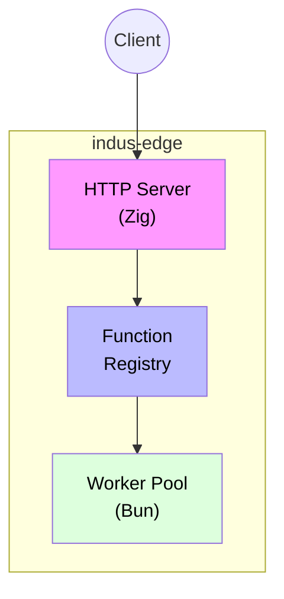
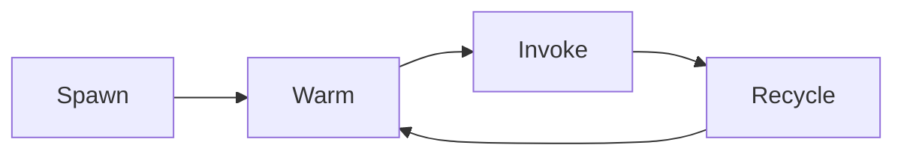

# indus-edge - Edge Functions Runtime

> Serverless edge functions runtime - like Cloudflare Workers (Zig + Bun)

## Overview

`indus-edge` is a Zig runtime manager that spawns isolated Bun processes per function invocation. It's like Cloudflare Workers but running on your own infrastructure.

## Architecture



## Features

- **Isolated Workers**: Each function runs in a separate Bun process
- **Warm Pool**: Pre-warmed workers for low-latency invocations
- **Hot Reload**: Automatic reloading when files change
- **Resource Limits**: Memory, CPU, and file descriptor limits
- **Structured Logging**: JSON-formatted logs
- **Health Checks**: Built-in health endpoints

## Environment Variables

| Variable | Default | Description |
|----------|---------|-------------|
| `INDUS_EDGE_PORT` | `8006` | HTTP server port |
| `INDUS_FUNCTIONS_DIR` | `/var/indusbase/functions` | Functions directory |
| `INDUS_BUN_PATH` | `/usr/local/bin/bun` | Bun binary path |
| `INDUS_HANDLER_PATH` | `/opt/indus-edge/runtime/handler.ts` | Handler script |
| `INDUS_WARMPOOL_SIZE` | `3` | Warm workers per function |
| `INDUS_WORKER_MEMORY_MB` | `128` | Memory limit per worker |
| `INDUS_WORKER_TIMEOUT_MS` | `30000` | Worker timeout |
| `INDUS_MAX_CONCURRENT` | `100` | Max concurrent invocations |
| `INDUS_INTERNAL_SECRET` | - | Internal auth secret |
| `INDUS_API_URL` | `http://localhost:8000` | API URL |

## Quick Start

```bash
# Build
zig build

# Run locally
./zig-out/bin/indus-edge

# Docker
docker build -t indus-edge:latest .
docker run -p 8006:8006 \
  -v $(pwd)/functions:/var/indusbase/functions \
  indus-edge:latest
```

## Writing Functions

Create TypeScript files in the functions directory:

```typescript
/**
 * @route /api/hello
 * @public
 * @version 1.0.0
 * @description A simple hello world function
 */

interface Context {
  req: Request;
  url: URL;
  headers: Headers;
  method: string;
  query: Record<string, string>;
  env: Record<string, string>;
  log: (...args: unknown[]) => void;
}

export default async function handler(ctx: Context): Promise<Response> {
  ctx.log("Handling request", ctx.url.pathname);
  
  return new Response(JSON.stringify({
    message: "Hello from Indus Edge!",
    timestamp: new Date().toISOString(),
  }), {
    status: 200,
    headers: { "Content-Type": "application/json" },
  });
}
```

## Function Annotations

| Annotation | Description |
|------------|-------------|
| `@route` | HTTP route path |
| `@public` | Public endpoint (no auth required) |
| `@private` | Requires authentication |
| `@version` | Function version |
| `@description` | Function description |
| `@timeout` | Timeout in milliseconds |
| `@memory` | Memory limit in MB |

## API Endpoints

### Health

| Method | Endpoint | Description |
|--------|----------|-------------|
| GET | `/health` | Service health check |
| GET | `/functions/:name/health` | Function health check |

### Functions

| Method | Endpoint | Description |
|--------|----------|-------------|
| GET | `/functions` | List all functions |
| POST | `/functions/:name` | Invoke a function |
| POST | `/functions/:name/invoke` | Invoke a function |

## Worker Lifecycle



1. **Spawn**: Bun process is forked with resource limits
2. **Warm**: Function code is loaded but idle
3. **Invoke**: Request is sent via stdin, response via stdout
4. **Recycle**: Worker returns to idle pool or is killed

## Security

- Workers run with limited resources (rlimit)
- Each function in isolated process
- No shared state between invocations
- Request timeout enforcement

## Example: Database Query

```typescript
interface Context {
  req: Request;
  url: URL;
  headers: Headers;
  method: string;
  query: Record<string, string>;
  env: Record<string, string>;
  log: (...args: unknown[]) => void;
  db: {
    query: (sql: string, params?: any[]) => Promise<any[]>;
  };
}

/**
 * @route /api/users
 * @public
 */
export default async function(ctx: Context): Promise<Response> {
  const users = await ctx.db.query(
    "SELECT * FROM users LIMIT $1",
    [10]
  );
  
  return new Response(JSON.stringify(users), {
    headers: { "Content-Type": "application/json" }
  });
}
```

## Example: Authenticated Function

```typescript
/**
 * @route /api/profile
 * @private
 */
export default async function(ctx: Context): Promise<Response> {
  // User is already validated by indus-gate
  const userId = ctx.headers.get("x-user-id");
  
  const profile = await ctx.db.query(
    "SELECT * FROM profiles WHERE user_id = $1",
    [userId]
  );
  
  return new Response(JSON.stringify(profile[0]), {
    headers: { "Content-Type": "application/json" }
  });
}
```

## Performance

- Pre-warmed workers reduce cold start
- Process isolation prevents crashes
- Resource limits prevent runaway functions

## License

MIT License
