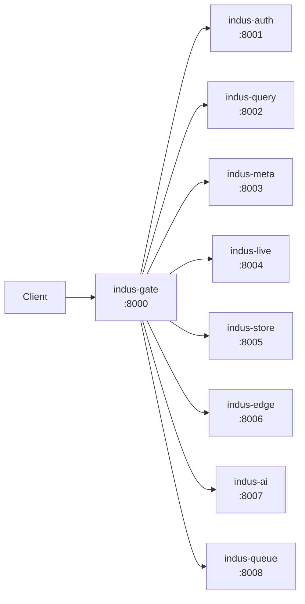
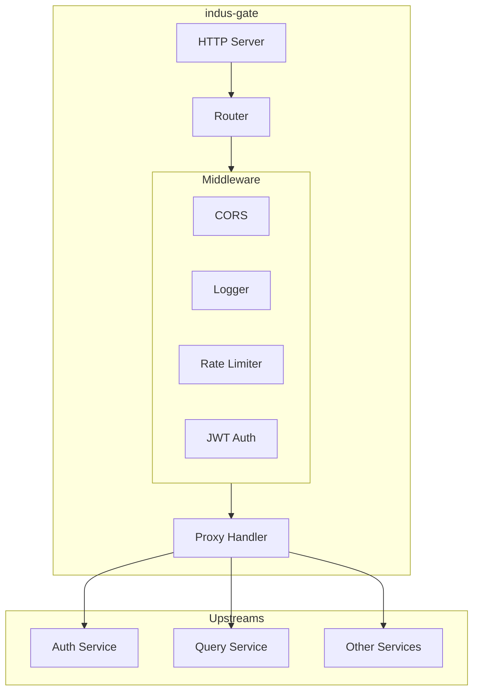

# 🌊 indus-gate - API Gateway

The **indus-gate** service is the single public entry point for all IndusBase services. Built with **Zig 0.14**, it handles routing, rate limiting, JWT validation, CORS, and request logging.

## Overview



## Features

- ✅ **HTTP Routing** - Routes requests to internal services
- ✅ **JWT Validation** - Pre-validates JWT tokens
- ✅ **Rate Limiting** - Token bucket per IP
- ✅ **CORS** - Handles cross-origin requests
- ✅ **Request Logging** - JSON structured logging
- ✅ **TLS Support** - HTTPS termination

## Configuration

### Environment Variables

| Variable | Default | Description |
|----------|---------|-------------|
| `SERVER_PORT` | 8000 | HTTP server port |
| `INTERNAL_SECRET` | - | Secret for internal communication |
| `UPSTREAM_AUTH` | http://indus-auth:8001 | Auth service URL |
| `UPSTREAM_QUERY` | http://indus-query:8002 | Query service URL |
| `UPSTREAM_META` | http://indus-meta:8003 | Meta service URL |
| `UPSTREAM_LIVE` | http://indus-live:8004 | Live service URL |
| `UPSTREAM_STORE` | http://indus-store:8005 | Store service URL |
| `UPSTREAM_EDGE` | http://indus-edge:8006 | Edge service URL |
| `UPSTREAM_AI` | http://indus-ai:8007 | AI service URL |
| `UPSTREAM_QUEUE` | http://indus-queue:8008 | Queue service URL |

### Routes

| Path | Service | JWT Required |
|------|---------|--------------|
| `/auth/*` | indus-auth | No |
| `/rest/*` | indus-query | Yes |
| `/meta/*` | indus-meta | Yes |
| `/realtime/*` | indus-live | Yes |
| `/storage/*` | indus-store | Yes |
| `/functions/*` | indus-edge | Yes |
| `/ai/*` | indus-ai | Yes |
| `/queue/*` | indus-queue | Yes |

## Architecture



## Project Structure

```
indus-gate/
├── build.zig              # Zig build config
├── build.zig.zon          # Zig package manager
├── Dockerfile             # Multi-stage build
├── config/
│   └── default.json      # Default configuration
├── src/
│   ├── main.zig          # Entry point
│   ├── root.zig          # Module exports
│   ├── config/
│   │   ├── config.zig    # Config loading
│   │   └── routes.zig   # Route definitions
│   ├── proxy/
│   │   ├── proxy.zig    # Proxy handler
│   │   ├── upstream.zig # Upstream management
│   │   └── balancer.zig # Load balancer
│   ├── middleware/
│   │   ├── auth.zig     # JWT validation
│   │   ├── ratelimit.zig # Rate limiting
│   │   ├── cors.zig     # CORS handling
│   │   └── logger.zig   # Request logging
│   ├── tls/
│   │   └── tls.zig      # TLS config
│   └── health/
│       └── health.zig   # Health checks
└── tests/
    ├── auth_test.zig
    ├── proxy_test.zig
    └── ratelimit_test.zig
```

## Building

```bash
cd indus-gate
zig build -Drelease-safe
```

## Running

```bash
# With Docker
docker build -t indus-gate .
docker run -p 8000:8000 indus-gate
```

## Rate Limiting

The rate limiter uses a token bucket algorithm:

- Default: 100 requests per minute per IP
- Configurable via `config/default.json`

```json
{
  "rate_limit": {
    "requests_per_minute": 100,
    "burst": 10
  }
}
```

## Health Check

```bash
curl http://localhost:8000/health
```

Response:
```json
{
  "status": "healthy",
  "services": {
    "auth": "up",
    "query": "up",
    "meta": "up",
    "live": "up",
    "store": "up",
    "edge": "up",
    "ai": "up",
    "queue": "up"
  }
}
```
