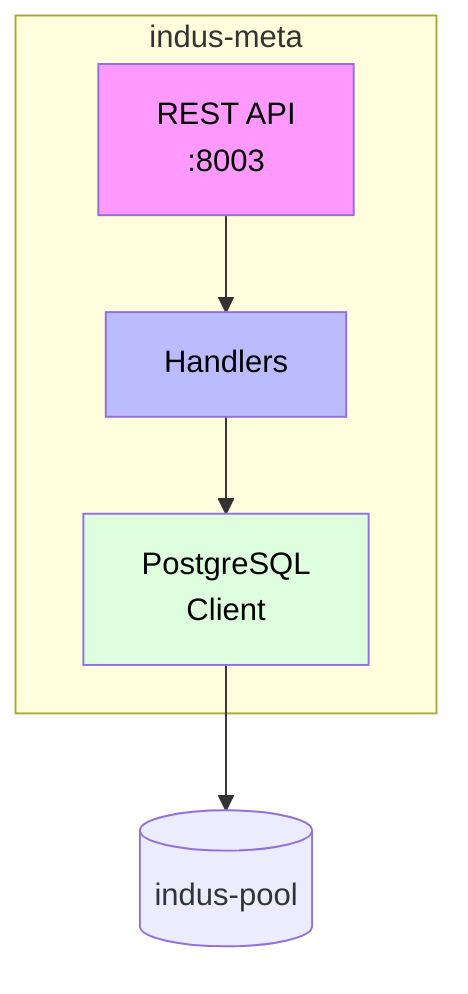

# indus-meta - DDL Management

> PostgreSQL metadata management API (Go 1.23)

## Overview

`indus-meta` is a Go 1.23 microservice that provides a RESTful API for managing PostgreSQL database metadata. It handles schemas, tables, columns, indexes, roles, extensions, functions, RLS policies, and migrations.

## Purpose

- **Schema Management**: Create, list, and drop schemas
- **Table Management**: Create, alter, and drop tables
- **Column Management**: Add, modify, and remove columns
- **Index Management**: Create and manage indexes
- **Role Management**: Create PostgreSQL roles and manage privileges
- **Extension Management**: Enable/disable PostgreSQL extensions
- **Function Management**: Create and manage database functions
- **RLS Policies**: Manage Row-Level Security policies
- **Migrations**: Run and rollback database migrations

## API Endpoints

### Schemas

| Method | Endpoint | Description |
|--------|----------|-------------|
| GET | `/meta/schemas` | List all schemas |
| POST | `/meta/schemas` | Create a new schema |
| DELETE | `/meta/schemas/:name` | Drop a schema |

### Tables

| Method | Endpoint | Description |
|--------|----------|-------------|
| GET | `/meta/tables` | List tables (optionally filter by schema) |
| POST | `/meta/tables` | Create a new table |
| PATCH | `/meta/tables/:schema/:name` | Alter a table |
| DELETE | `/meta/tables/:schema/:name` | Drop a table |

### Columns

| Method | Endpoint | Description |
|--------|----------|-------------|
| GET | `/meta/columns/:schema/:table` | List columns for a table |
| POST | `/meta/columns/:schema/:table` | Add a column |
| PATCH | `/meta/columns/:schema/:table/:column` | Alter a column |
| DELETE | `/meta/columns/:schema/:table/:column` | Drop a column |

### Indexes

| Method | Endpoint | Description |
|--------|----------|-------------|
| GET | `/meta/indexes/:schema/:table` | List indexes |
| POST | `/meta/indexes` | Create an index |
| DELETE | `/meta/indexes/:schema/:name` | Drop an index |

### Roles

| Method | Endpoint | Description |
|--------|----------|-------------|
| GET | `/meta/roles` | List all roles |
| POST | `/meta/roles` | Create a role |
| PATCH | `/meta/roles/:name` | Alter a role |
| DELETE | `/meta/roles/:name` | Drop a role |
| POST | `/meta/roles/:name/grant` | Grant privileges |

### Extensions

| Method | Endpoint | Description |
|--------|----------|-------------|
| GET | `/meta/extensions` | List available/enabled extensions |
| POST | `/meta/extensions` | Enable an extension |
| DELETE | `/meta/extensions/:name` | Disable an extension |

### Functions

| Method | Endpoint | Description |
|--------|----------|-------------|
| GET | `/meta/functions/:schema` | List functions |
| POST | `/meta/functions` | Create a function |
| DELETE | `/meta/functions/:schema/:name` | Drop a function |

### RLS Policies

| Method | Endpoint | Description |
|--------|----------|-------------|
| GET | `/meta/policies/:schema/:table` | List RLS policies |
| POST | `/meta/policies` | Create a policy |
| PATCH | `/meta/policies/:schema/:table/:name` | Alter a policy |
| DELETE | `/meta/policies/:schema/:table/:name` | Drop a policy |

### Migrations

| Method | Endpoint | Description |
|--------|----------|-------------|
| GET | `/meta/migrations` | Get migration history |
| POST | `/meta/migrations/run` | Run a migration |
| POST | `/meta/migrations/rollback` | Rollback a migration |

### Query

| Method | Endpoint | Description |
|--------|----------|-------------|
| POST | `/meta/query` | Execute raw SQL (admin only) |

## Environment Variables

| Variable | Default | Description |
|----------|---------|-------------|
| `DATABASE_URL` | - | PostgreSQL connection string |
| `PORT` | `8003` | HTTP server port |
| `INTERNAL_AUTH_SECRET` | - | Secret for internal auth |

## Quick Start

```bash
# Run the server
go run cmd/server/main.go

# Docker
docker build -t indus-meta .
docker run -p 8003:8003 --env-file .env indus-meta
```

## Example Usage

### Create a Table

```bash
curl -X POST http://localhost:8003/meta/tables \
  -H "Content-Type: application/json" \
  -H "Authorization: Bearer <internal-secret>" \
  -d '{
    "schema": "public",
    "name": "users",
    "columns": [
      {"name": "id", "type": "uuid", "primary_key": true},
      {"name": "email", "type": "varchar(255)", "not_null": true},
      {"name": "created_at", "type": "timestamp", "default": "NOW()"}
    ]
  }'
```

### Add a Column

```bash
curl -X POST http://localhost:8003/meta/columns/public/users \
  -H "Content-Type: application/json" \
  -d '{
    "name": "full_name",
    "type": "varchar(255)"
  }'
```

### Create an Index

```bash
curl -X POST http://localhost:8003/meta/indexes \
  -H "Content-Type: application/json" \
  -d '{
    "schema": "public",
    "table": "users",
    "name": "idx_users_email",
    "columns": ["email"],
    "unique": true
  }'
```

## Architecture



## Security

- Internal-only service (verified from indus-gate)
- Raw SQL endpoint restricted to admin users
- All operations logged for audit

## License

MIT License
