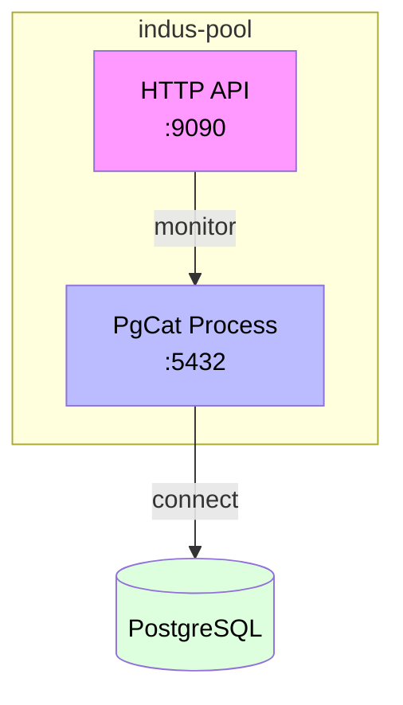
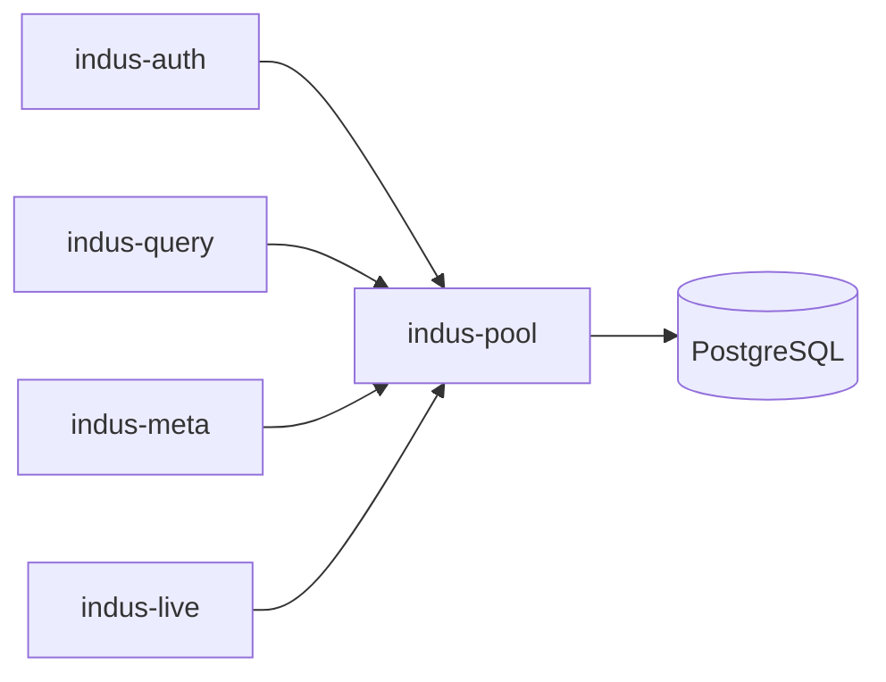

# indus-pool - Connection Pooler

> PostgreSQL connection pooling service built on PgCat (Rust)

## Overview

`indus-pool` is a Rust microservice that wraps **PgCat** - a high-performance PostgreSQL connection pooler. This service manages the PgCat child process and exposes health check and Prometheus metrics endpoints.

## Purpose

Indus Pool provides:
- Process management for PgCat (spawn, monitor, restart on crash)
- Health check endpoint at `/health`
- Prometheus metrics at `/metrics`
- Admin endpoints for pool management (`/pool/reload`, `/pool/stats`)
- PostgreSQL protocol proxy on port 5432

## Architecture



## API Endpoints

### Health Endpoints

| Endpoint | Method | Description |
|----------|--------|-------------|
| `/health` | GET | Health check - returns 200 if PgCat is running |
| `/health/ready` | GET | Readiness probe - checks PostgreSQL connectivity |
| `/health/live` | GET | Liveness probe - checks if service is alive |

### Metrics Endpoints

| Endpoint | Method | Description |
|----------|--------|-------------|
| `/metrics` | GET | Prometheus metrics in text format |

### Admin Endpoints

| Endpoint | Method | Description |
|----------|--------|-------------|
| `/pool/reload` | POST | Reload PgCat configuration |
| `/pool/stats` | GET | Get pool statistics |

## Environment Variables

| Variable | Default | Description |
|----------|---------|-------------|
| `PGCAT_CONFIG_PATH` | `./config/pgcat.toml` | Path to PgCat configuration |
| `PGCAT_BINARY_PATH` | `/usr/local/bin/pgcat` | Path to PgCat binary |
| `METRICS_PORT` | `9090` | Port for health/metrics endpoints |
| `PG_PORT` | `5432` | Port for PostgreSQL protocol |
| `RUST_LOG` | `info` | Log level |
| `RESTART_DELAY_SECS` | `5` | Seconds to wait before restarting crashed PgCat |

## Quick Start

### Running Locally

```bash
# Set required environment variables
export PGCAT_CONFIG_PATH=./config/pgcat.toml
export PGCAT_BINARY_PATH=/usr/local/bin/pgcat
export METRICS_PORT=9090
export PG_PORT=5432

# Run the service
cargo run
```

### Docker

```bash
docker build -t indus-pool .
docker run -p 5432:5432 -p 9090:9090 indus-pool
```

## Configuration

### PgCat Configuration

The main configuration is in `config/pgcat.toml`. See `config/pgcat.example.toml` for a fully documented example.

```toml
[pools]
# Pool configurations
[pool.my_database]
  pool_mode = "transaction"
  default_role = "reader"
  
[pool.my_database.shards]
  # Shard configuration
  0.host = "127.0.0.1"
  0.port = 5432
  0.database = "mydb"

[settings]
# Global settings
admin_listen_addr = "0.0.0.0:54310"
```

## Connection Pooling Modes

PgCat supports different pool modes:

| Mode | Description |
|------|-------------|
| `session` | A connection is bound to a client for the duration of the session |
| `transaction` | Connections are borrowed and returned after each transaction |
| `statement` | Each statement gets its own connection |

## Monitoring

### Prometheus Metrics

The service exposes the following metrics:

- `pgcat_active_connections` - Number of active connections
- `pgcat_idle_connections` - Number of idle connections  
- `pgcat_wait_time_seconds` - Average wait time for a connection
- `pgcat_errors_total` - Total number of errors

### Health Checks

```bash
# Check health
curl http://localhost:9090/health

# Check readiness
curl http://localhost:9090/health/ready

# Get metrics
curl http://localhost:9090/metrics
```

## Integration

All services connect to PostgreSQL through indus-pool:



## Troubleshooting

### PgCat Not Starting

Check logs:
```bash
docker logs indus-pool
```

Verify configuration:
```bash
curl http://localhost:9090/pool/stats
```

### High Connection Wait Times

- Increase pool size in `pgcat.toml`
- Check for long-running queries
- Consider using connection pooling mode

## License

MIT License
