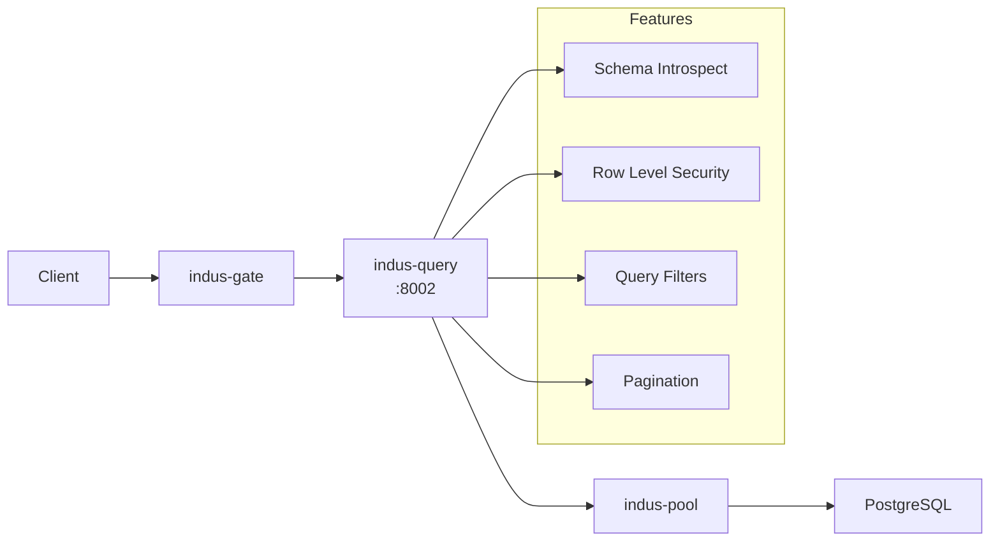
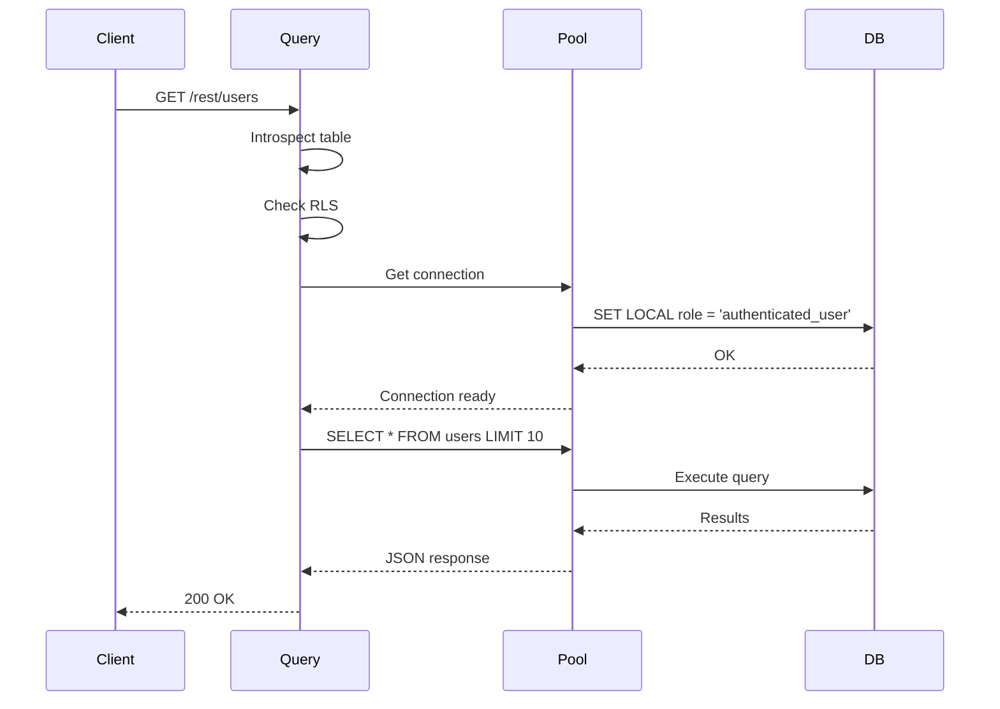

# 🗄️ indus-query - Auto REST API Service

The **indus-query** service automatically generates REST APIs from your PostgreSQL database schema. Built with **Rust**, it provides instant CRUD operations with Row Level Security (RLS).

## Overview



## Features

- ✅ **Auto CRUD** - Instant REST API from schema
- ✅ **Row Level Security** - Per-user data isolation
- ✅ **Query Filters** - eq, neq, gt, lt, like, ilike, in
- ✅ **Pagination** - Limit/offset with counts
- ✅ **Ordering** - Order by any column
- ✅ **Partial Selects** - Select specific columns
- ✅ **PostGIS Support** - Spatial queries
- ✅ **GraphQL** - GraphQL API (stub)

## How It Works

1. **Introspection** - Reads table/column metadata from `information_schema`
2. **Route Generation** - Creates routes for each table
3. **RLS Integration** - Enforces PostgreSQL RLS policies
4. **Query Building** - Builds parameterized SQL queries



## API Endpoints

For a table named `users`:

| Method | Endpoint | Description |
|--------|----------|-------------|
| GET | `/rest/:table` | List rows |
| GET | `/rest/:table/:id` | Get single row |
| POST | `/rest/:table` | Insert row |
| PATCH | `/rest/:table/:id` | Update row |
| DELETE | `/rest/:table/:id` | Delete row |

## Query Parameters

| Parameter | Example | Description |
|-----------|---------|-------------|
| `select` | `select=id,name,email` | Columns to return |
| `eq.column` | `eq.status=active` | Equal filter |
| `neq.column` | `neq.role=admin` | Not equal |
| `gt.column` | `gt.age=18` | Greater than |
| `gte.column` | `gte.score=50` | Greater or equal |
| `lt.column` | `lt.price=100` | Less than |
| `lte.column` | `lte.stock=0` | Less or equal |
| `like` | `like.name=%john%` | LIKE filter |
| `ilike` | `ilike.email=@gmail.com` | Case-insensitive LIKE |
| `in` | `in.status=a,b,c` | IN filter |
| `order` | `order=created_at.desc` | Ordering |
| `limit` | `limit=20` | Row limit |
| `offset` | `offset=10` | Pagination offset |

## Examples

### List Users

```bash
curl -H "Authorization: Bearer $TOKEN" \
  "http://localhost:8002/rest/users?select=id,email,full_name&eq.status=active&order=created_at.desc&limit=10"
```

### Filter and Paginate

```bash
curl -H "Authorization: Bearer $TOKEN" \
  "http://localhost:8002/rest/products?gte.price=100&lte.price=500&order=price.asc&limit=20&offset=0"
```

### Insert

```bash
curl -X POST -H "Authorization: Bearer $TOKEN" \
  -H "Content-Type: application/json" \
  -d '{"email": "new@example.com", "full_name": "New User"}' \
  "http://localhost:8002/rest/users"
```

### Update

```bash
curl -X PATCH -H "Authorization: Bearer $TOKEN" \
  -H "Content-Type: application/json" \
  -d '{"full_name": "Updated Name"}' \
  "http://localhost:8002/rest/users/123"
```

## Row Level Security (RLS)

indus-query enforces PostgreSQL RLS policies:

```sql
-- Create table with RLS
CREATE TABLE profiles (
    id UUID PRIMARY KEY DEFAULT gen_random_uuid(),
    user_id UUID REFERENCES auth.users(id),
    bio TEXT,
    created_at TIMESTAMPTZ DEFAULT NOW()
);

-- Enable RLS
ALTER TABLE profiles ENABLE ROW LEVEL SECURITY;

-- Create policy
CREATE POLICY "Users can view own profile"
    ON profiles FOR SELECT
    USING (auth.uid() = user_id);
```

The service automatically:
1. Extracts user ID from JWT
2. Sets session variable `request.jwt.claim`
3. Executes query with RLS enforced

## Project Structure

```
indus-query/
├── Cargo.toml
├── Cargo.lock
├── Dockerfile
├── src/
│   ├── main.rs
│   ├── lib.rs
│   ├── config.rs
│   ├── errors.rs
│   ├── schema/
│   │   ├── mod.rs
│   │   ├── introspect.rs
│   │   ├── types.rs
│   │   └── cache.rs
│   ├── rest/
│   │   ├── mod.rs
│   │   ├── router.rs
│   │   ├── handler.rs
│   │   ├── filter.rs
│   │   ├── query_builder.rs
│   │   └── response.rs
│   ├── graphql/
│   │   ├── mod.rs
│   │   └── schema.rs (stub)
│   ├── db/
│   │   ├── mod.rs
│   │   ├── pool.rs
│   │   └── executor.rs
│   ├── auth/
│   │   ├── mod.rs
│   │   ├── jwt.rs
│   │   └── rls.rs
│   └── middleware/
│       ├── mod.rs
│       ├── auth.rs
│       └── logger.rs
├── tests/
│   ├── rest_test.rs
│   ├── filter_test.rs
│   └── rls_test.rs
└── benches/
    └── query_bench.rs
```

## Configuration

### Environment Variables

| Variable | Default | Description |
|----------|---------|-------------|
| `SERVER_PORT` | 8002 | Server port |
| `DATABASE_URL` | - | PostgreSQL connection |
| `JWT_SECRET` | - | JWT verification key |
| `SCHEMA_CACHE_TTL` | 300 | Cache TTL in seconds |

## Performance

- **Schema Cache** - Cached for 5 minutes
- **Connection Pool** - Managed by indus-pool
- **Parameterized Queries** - SQL injection safe
- **Index Usage** - Optimizer-friendly queries

## Benchmarks

```bash
cargo bench
```

Typical results:
- Single row lookup: ~1ms
- List 100 rows: ~5ms
- Filtered query: ~3ms
