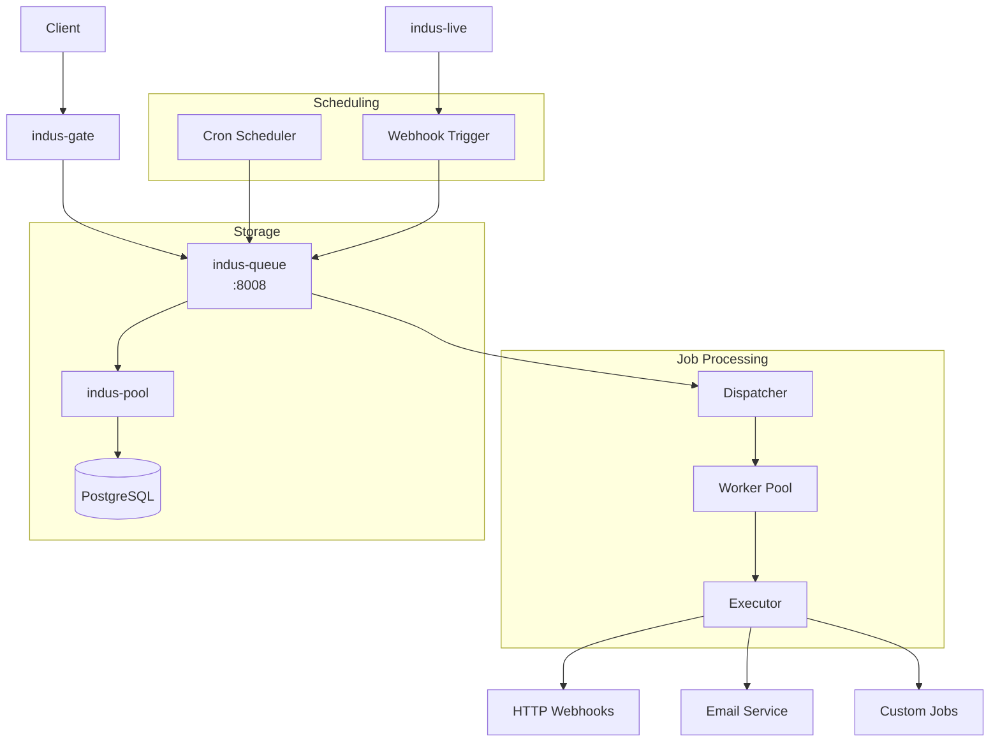
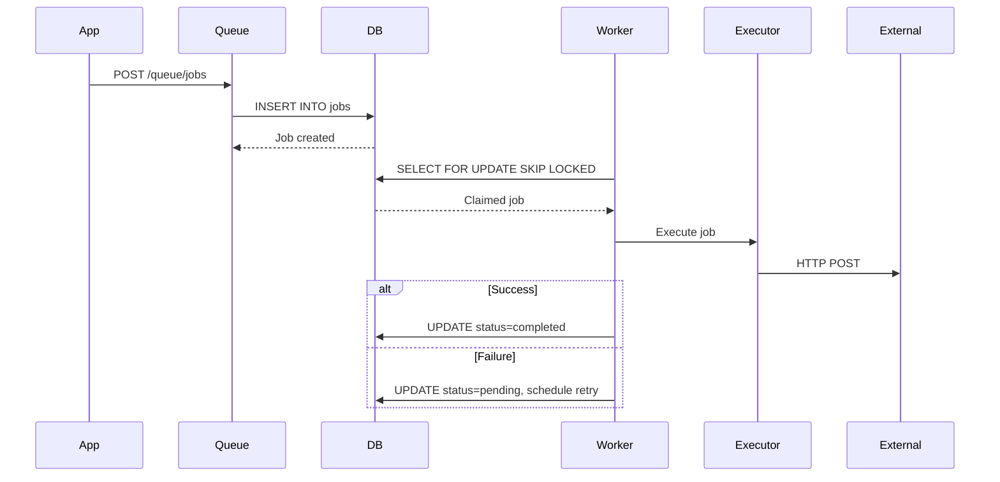

# 📋 indus-queue - Background Jobs Service

The **indus-queue** service provides background job processing, webhook delivery, and cron scheduling. Built with **Go**, it uses PostgreSQL as the queue backend (PGMQ-style).

## Overview



## Features

- ✅ **Job Queue** - PGMQ-style with FOR UPDATE SKIP LOCKED
- ✅ **Webhooks** - Trigger HTTP on database changes
- ✅ **Cron Jobs** - Scheduled tasks (IST timezone)
- ✅ **Retry Logic** - Exponential backoff
- ✅ **Dead Letter Queue** - Failed job handling
- ✅ **Batch Operations** - Bulk enqueue/dequeue

## How It Works

### Job Queue (PGMQ-style)

1. **Enqueue** - Insert job with payload
2. **Dequeue** - Atomic claim with FOR UPDATE SKIP LOCKED
3. **Process** - Execute job in worker
4. **Ack** - Mark completed
5. **Retry** - On failure, schedule retry with backoff



## API Endpoints

### Jobs

| Method | Endpoint | Description |
|--------|----------|-------------|
| POST | `/queue/jobs` | Enqueue single job |
| POST | `/queue/jobs/batch` | Enqueue batch |
| GET | `/queue/jobs` | List jobs |
| GET | `/queue/jobs/:id` | Get job |
| POST | `/queue/jobs/:id/ack` | Mark completed |
| POST | `/queue/jobs/:id/fail` | Mark failed |
| DELETE | `/queue/jobs/:id` | Cancel job |

### Queues

| Method | Endpoint | Description |
|--------|----------|-------------|
| POST | `/queue/queues` | Create queue |
| GET | `/queue/queues` | List queues |
| DELETE | `/queue/queues/:name` | Delete queue |

### Webhooks

| Method | Endpoint | Description |
|--------|----------|-------------|
| POST | `/queue/webhooks` | Register webhook |
| GET | `/queue/webhooks` | List webhooks |
| GET | `/queue/webhooks/:id` | Get webhook |
| PATCH | `/queue/webhooks/:id` | Update webhook |
| DELETE | `/queue/webhooks/:id` | Delete webhook |
| POST | `/queue/webhooks/:id/test` | Test webhook |

### Cron

| Method | Endpoint | Description |
|--------|----------|-------------|
| POST | `/queue/cron` | Create schedule |
| GET | `/queue/cron` | List schedules |
| GET | `/queue/cron/:id` | Get schedule |
| PATCH | `/queue/cron/:id` | Update schedule |
| DELETE | `/queue/cron/:id` | Delete schedule |
| POST | `/queue/cron/:id/run-now` | Trigger immediately |

## Examples

### Enqueue Job

```bash
curl -X POST http://localhost:8008/queue/jobs \
  -H "Authorization: Bearer $TOKEN" \
  -H "Content-Type: application/json" \
  -d '{
    "queue_name": "default",
    "payload": {
      "action": "send_email",
      "to": "user@example.com",
      "template": "welcome"
    },
    "job_type": "http",
    "priority": 10
  }'
```

### Register Webhook

```bash
curl -X POST http://localhost:8008/queue/webhooks \
  -H "Authorization: Bearer $TOKEN" \
  -H "Content-Type: application/json" \
  -d '{
    "name": "user-created",
    "table_schema": "public",
    "table_name": "users",
    "events": ["INSERT"],
    "url": "https://your-app.com/webhooks/user-created",
    "secret": "your-signing-secret"
  }'
```

### Create Cron Job

```bash
curl -X POST http://localhost:8008/queue/cron \
  -H "Authorization: Bearer $TOKEN" \
  -H "Content-Type: application/json" \
  -d '{
    "name": "daily-digest",
    "cron_expression": "0 9 * * *",
    "target_queue": "default",
    "job_payload": {
      "action": "send_digest"
    },
    "job_type": "http",
    "timezone": "Asia/Kolkata"
  }'
```

## Cron Presets (India)

| Preset | Expression | Description |
|--------|------------|-------------|
| Daily 9am IST | `0 9 * * *` | Every day at 9am |
| Hourly | `0 * * * *` | Every hour |
| Weekdays 10am | `0 10 * * 1-5` | Mon-Fri at 10am |
| Every 5 min | `*/5 * * * *` | Every 5 minutes |
| Monthly | `0 0 1 * *` | 1st of month |

## Project Structure

```
indus-queue/
├── go.mod
├── go.sum
├── Dockerfile
├── cmd/
│   └── server/
│       └── main.go
├── internal/
│   ├── config/
│   │   └── config.go
│   ├── api/
│   │   ├── server.go
│   │   ├── routes.go
│   │   ├── middleware.go
│   │   └── response.go
│   ├── handlers/
│   │   ├── jobs.go
│   │   ├── queues.go
│   │   ├── webhooks.go
│   │   └── cron.go
│   ├── worker/
│   │   ├── dispatcher.go
│   │   ├── executor.go
│   │   └── retry.go
│   ├── scheduler/
│   │   └── cron.go
│   ├── db/
│   │   ├── postgres.go
│   │   └── migrations/
│   ├── models/
│   │   ├── job.go
│   │   ├── queue.go
│   │   ├── webhook.go
│   │   └── cron_schedule.go
│   └── repository/
│       ├── job_repo.go
│       ├── queue_repo.go
│       ├── webhook_repo.go
│       └── cron_repo.go
└── tests/
```

## Database Schema

### Jobs Table

```sql
CREATE TABLE indusbase_queue.jobs (
    id UUID PRIMARY KEY DEFAULT gen_random_uuid(),
    queue_name VARCHAR(100) NOT NULL,
    payload JSONB NOT NULL,
    status VARCHAR(20) DEFAULT 'pending',
    priority INTEGER DEFAULT 100,
    scheduled_at TIMESTAMPTZ DEFAULT NOW(),
    invisible_until TIMESTAMPTZ,
    worker_id TEXT,
    attempt_count INTEGER DEFAULT 0,
    max_retries INTEGER DEFAULT 3,
    last_error TEXT,
    job_type VARCHAR(100),
    created_by UUID,
    completed_at TIMESTAMPTZ,
    created_at TIMESTAMPTZ DEFAULT NOW(),
    updated_at TIMESTAMPTZ DEFAULT NOW()
);

-- Index for efficient dequeue
CREATE INDEX ON indusbase_queue.jobs(queue_name, status, scheduled_at)
    WHERE status = 'pending';
```

### Webhooks Table

```sql
CREATE TABLE indusbase_queue.webhooks (
    id UUID PRIMARY KEY DEFAULT gen_random_uuid(),
    name VARCHAR(100) NOT NULL,
    table_schema VARCHAR(100) DEFAULT 'public',
    table_name VARCHAR(100) NOT NULL,
    events TEXT[] NOT NULL,
    url TEXT NOT NULL,
    http_method VARCHAR(10) DEFAULT 'POST',
    headers JSONB DEFAULT '{}',
    secret TEXT,
    retry_count INTEGER DEFAULT 3,
    timeout_secs INTEGER DEFAULT 10,
    is_active BOOLEAN DEFAULT TRUE,
    owner_id UUID,
    created_at TIMESTAMPTZ DEFAULT NOW()
);
```

## Retry Logic

```
Attempt 1: 30 seconds delay
Attempt 2: 60 seconds delay  
Attempt 3: 120 seconds delay
Attempt 4: 240 seconds delay
```

After max retries:
- If dead letter queue exists → move to DLQ
- Otherwise → mark as 'dead'

## Configuration

### Environment Variables

| Variable | Default | Description |
|----------|---------|-------------|
| `SERVER_PORT` | 8008 | Server port |
| `DATABASE_URL` | - | PostgreSQL connection |
| `MAX_CONCURRENT_WORKERS` | 50 | Worker pool size |
| `POLL_INTERVAL_MS` | 1000 | Queue poll interval |
| `AUTH_SERVICE_URL` | http://indus-auth:8001 | Auth service |
| `LIVE_SERVICE_URL` | http://indus-live:8004 | Live service |
