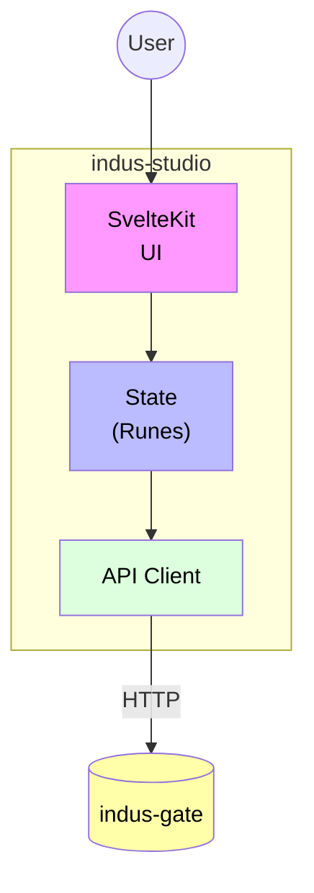

# indus-studio - Web Dashboard

> The browser-based dashboard for IndusBase (SvelteKit 5)

## Overview

IndusBase Studio is a modern, high-performance web dashboard built with **SvelteKit 5** and **TypeScript**. It provides a comprehensive interface for managing your IndusBase projects.

## Tech Stack

| Component | Technology |
|-----------|------------|
| Framework | SvelteKit 5 (Svelte 5 with runes) |
| Language | TypeScript 5.4 |
| Bundler | Vite 5 |
| Package Manager | Bun |
| UI Library | Custom + Tailwind CSS |
| Table Component | TanStack Svelte Table |
| Notifications | svelte-french-toast |

## Features

### Project Management
- Create and manage multiple projects
- Project settings and configuration
- Team collaboration

### Database Explorer
- Visual schema browser
- Table editor with CRUD operations
- Column management
- Index and constraint management

### Query Editor
- SQL query builder
- Query history
- Results visualization

### Authentication
- User management
- Role and permissions
- OAuth configuration
- API keys management

### Storage
- Bucket management
- File browser
- Upload management

### Edge Functions
- Function deployment
- Function monitoring
- Log viewer

### AI/Vector Search
- Collection management
- Document indexing
- Semantic search testing

### Settings
- Project settings
- Billing (future)
- API configuration

## Quick Start

```bash
# Install dependencies
bun install

# Start development server
bun run dev
```

The app will be available at `http://localhost:3000`.

## Environment Variables

| Variable | Default | Description |
|----------|---------|-------------|
| `PUBLIC_INDUSBASE_URL` | `http://localhost:8080` | IndusBase API URL |

## Screenshots

### Dashboard
The main dashboard shows:
- Project overview
- Quick stats
- Recent activity

### Database Explorer
Visual interface for:
- Viewing tables
- Editing rows
- Managing schema

### Query Builder
- Point-and-click query builder
- Raw SQL editor
- Results table

## Architecture



## Integration with Services

Studio communicates with:

| Service | Purpose |
|---------|---------|
| indus-gate | Authentication, routing |
| indus-auth | User management |
| indus-query | Database queries |
| indus-meta | Schema management |
| indus-store | File browser |
| indus-edge | Function management |
| indus-ai | Vector search |

## Development

```bash
# Run in development
bun run dev

# Build for production
bun run build

# Run tests
bun run test

# Lint
bun run lint

# Format
bun run format
```

## Project Structure

```
indus-studio/
├── src/
│   ├── lib/
│   │   ├── components/    # UI components
│   │   ├── stores/       # Svelte stores
│   │   ├── api/          # API client
│   │   └── utils/        # Utilities
│   ├── routes/           # SvelteKit routes
│   └── app.html          # HTML template
├── static/               # Static assets
├── package.json
└── svelte.config.js
```

## Customization

### Theme
The dashboard supports customization via CSS variables:

```css
:root {
  --primary: #6366f1;
  --secondary: #8b5cf6;
  --success: #22c55e;
  --warning: #f59e0b;
  --danger: #ef4444;
  --background: #ffffff;
  --foreground: #1f2937;
}
```

### Components
Custom components can be added in `src/lib/components/`.

## License

MIT License - part of the IndusBase project.
